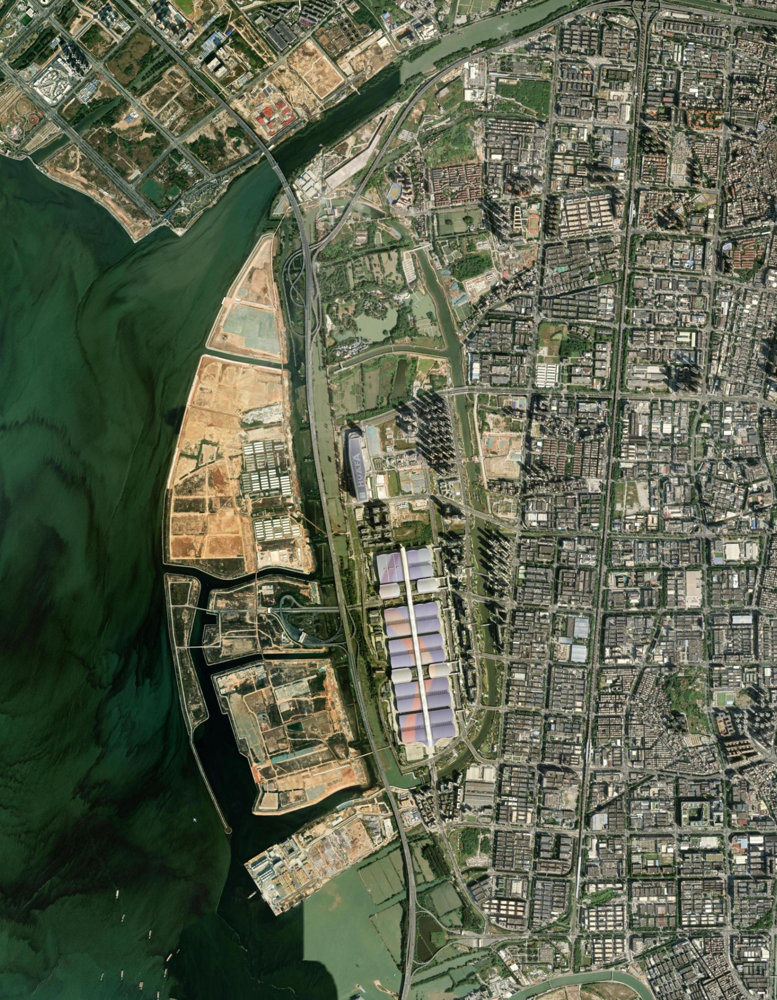

# 01 宝安河口沿岸：河口、海堤与工程水道踏勘

评估日期：2026年10月10日。

以茅洲河口深圳侧至海洋新城、会展片区与福海北部岸线为范围，逐段阅读22幅卫星影像，并结合钓友帖子、视频与现场评论，分析鱼情、玩法、实际进出和人流。

宝安这一带同时有河口支汊、块石护岸、闸口、工程海堤和作业岸线。钓友内容提示罗非、俗称“趴地虎”的小鱼、潮汐走水及入口差异；可精确对应七处参考点的实钓证据仍不足。先比较河口和可接近护岸，工程外海堤与码头保留为待核岸段。

[专题网页](baoan-estuary.html) · [01分区](atlas.html#S01) · [七点评估表](baoan-estuary.csv)

## 地点索引

| 编号 | 岸段 | 行程建议 | 首要问题 |
|---|---|---|---|
| [B01](baoan-estuary.html#B01) | 茅洲河口深圳侧支汊与湿地外缘 | 先查边界 | 河口与支汊交汇清楚，湿地边缘的公众落脚点未核实 |
| [B02](baoan-estuary.html#B02) | 茅洲河口南侧闸泵设施外缘 | 先查边界 | 闸孔、护岸和桥影可辨，先查工程设施范围 |
| [B03](baoan-estuary.html#B03) | 海洋新城北部外海直线海堤 | 行程后置 | 外海堤形清楚，陆侧工程场地使岸钓行程后置 |
| [B04](baoan-estuary.html#B04) | 会展片区西侧入海通道桥与护岸 | 先查边界 | 桥侧石护岸与通道可比较，生产道路使用条件待查 |
| [B05](baoan-estuary.html#B05) | 会展片区南部通道弯折护岸 | 先查边界 | 堤脚裸露和转角可见，施工与通行现状待确认 |
| [B06](baoan-estuary.html#B06) | 福海北部作业码头岸线 | 行程后置 | 作业码头与堆场明确，公众岸钓行程后置 |
| [B07](baoan-estuary.html#B07) | 海洋新城南侧长堤端头 | 行程后置 | 外海长堤端头单独评估，堤顶用途与进入条件待查 |

## 深圳出发 · 矶竿用途

从宝安北部与光明出发可先核河口入口，但B01—B07尚无已核实的平整公众钓位，不作默认练手或大鱼专程。B01、B04、B05可先查入口；B02设施、B03工程海堤、B06作业码头和B07长堤各按使用条件安排。

[练手与较大鱼用途分类](shenzhen-outings.html) · [文字版](shenzhen-outings.md)

## 钓友实钓与现场体验

公开内容提供了罗非夜口、潮汐走水、块石护岸坐钓、挂底、导航失败和空军等线索。最接近河口的是2025年探钓视频，但具体岸侧仍未定位；2026年“趴地虎”视频只到河名。七处影像参考点尚无一处获得能同时核对岸形、入口与渔获的实钓帖。

### 鱼情要分河段，也要保留空军

沙四评论说罗非夜口好；福永近邻河道有人自述海鲈、花身鱼，也有人从下午搜到晚间仍空军。上游土鲮实钓有较完整的饵料和定位，却不能算成河口渔获。B01—B07的黑鲷、石斑、石狗公等目标仍没有点位实钓证据。

依据：[沙四村茅洲河钓友点评｜钓鱼之家／钓鱼人](https://m.diaoyu.com/diaochang/shenzhen/237711.html)；[福永海鲜市场后河道实钓点评｜钓鱼之家／钓鱼人](https://m.diaoyu.com/diaochang/shenzhen/219545.html)；[茅洲河土鲮实钓与作者答复｜钓鱼之家／钓鱼人](https://m.diaoyu.com/showtopic-6198259-1-1.html)

### 先找实际岸边与入口，再谈交通方便

河口视频片段可见块石护岸上坐钓；东宝河用户反映地图点难找、昼夜限制。视频未定位到B01，评论也未核对具体桥。第一轮行程应先对照河口块石护岸、桥名、闸口和哪一岸；不要导航到水面中心或厂区门口就默认能下竿。

依据：[茅洲河口探钓视频｜哔哩哔哩](https://www.bilibili.com/video/BV1Pp1yBLE9v/)；[东宝河入口与劝离反馈｜钓鱼之家／钓鱼人](https://m.diaoyu.com/diaochang/shenzhen/217504.html)

### 潮汐、夜口和挂底是值得验证的变量

潮汐与走水多次出现在沿河简介、点评中；罗非夜口是单条无日期经验。先在白天查入口和岸形，再在可用岸段记录实际流向、潮相、饵料、试钓时长和零渔获。没有足够记录给出宝安河口统一的最佳潮位或月份。

依据：[沙四村茅洲河钓友点评｜钓鱼之家／钓鱼人](https://m.diaoyu.com/diaochang/shenzhen/237711.html)；[福永海鲜市场后河道实钓点评｜钓鱼之家／钓鱼人](https://m.diaoyu.com/diaochang/shenzhen/219545.html)

### 有讨论热度，不能据此判断低钓压

沙四简介和上游实钓答复都说钓者多，不能把茅洲河笼统写为冷门。河口视频只证明某次画面有两位钓者；B03—B07工程岸段缺少可定位的钓友内容，未搜到帖子不能说明鱼多、人少或未被钓过。

依据：[沙四村茅洲河钓友点评｜钓鱼之家／钓鱼人](https://m.diaoyu.com/diaochang/shenzhen/237711.html)；[茅洲河土鲮实钓与作者答复｜钓鱼之家／钓鱼人](https://m.diaoyu.com/showtopic-6198259-1-1.html)；[茅洲河口探钓视频｜哔哩哔哩](https://www.bilibili.com/video/BV1Pp1yBLE9v/)

### 相互矛盾的进出体验都保留

2023年沙井视频说“没人赶”，东宝河评论说昼夜限制。两者地点粒度不同，后者日期不明，无法排出先后。报告把它们作为到场核查线索，并保留官方管理范围用于解释现场标牌；不把任何一条个人经历扩展为全线状态。

依据：[沙井茅洲河“没人赶”视频｜哔哩哔哩](https://www.bilibili.com/video/BV1rw41187Ce/)；[东宝河入口与劝离反馈｜钓鱼之家／钓鱼人](https://m.diaoyu.com/diaochang/shenzhen/217504.html)

## 帖子与七处影像参考点的关系

| 参考点 | 对应程度 | 线索含义 |
|---|---|---|
| B01、B02 | 河口片区相关，未精确匹配 | 2025年河口视频可见护岸坐钓；沙四、东宝河点评提供沿河玩法与进出问题。没有一条确认B01窄堤路或B02具体闸泵设施。 |
| B03、B04、B05 | 没有可定位的实钓证据 | “海上田园”视频水面未定位，不能对应外海直线堤、通道桥或弯折护岸。鱼塘和河道同名线索不计入这些工程岸段的渔获。 |
| B06、B07 | 没有可定位的实钓证据 | 福永海鲜市场后河道有个人渔获评论，但没有证据对应福海作业码头或长堤端头。码头、长堤的钓压、入口和鱼情继续单独核查。 |

## 逐条读帖

### 茅洲河口探钓视频

[哔哩哔哩原帖](https://www.bilibili.com/video/BV1Pp1yBLE9v/) · 深圳亿哥 · 2025-11-04

**地点范围：**作者标题指茅洲河出海口、深莞交界；尚未定位到哪一岸、哪一桥。

**渔获与空军：**可见片段未确认渔获，不从“探钓”标题推断鱼种。

**钓法与时机：**画面为河面、对岸植被和建筑；未核实潮相、饵料、时长。

**进出与站位：**可见两位钓者在大块石护岸上坐钓，不能认定是B01窄堤路。

**人流与钓压：**一个画面可见两位钓者；不能推出日常人流或低钓压。

**踏勘含义：**人工块石护岸是实际岸钓场景；B01附近调查应同时寻找河岸护砌与支汊交汇，不能只找天然礁石。

**实际读取范围：**原帖标题、作者、日期与可播放片段画面已核；未看完整视频，评论未成功加载。

**证据限度：**地点仅到河口片区。画面可见有人钓鱼，当前公众入口和使用条件仍未确认。

### 沙四村茅洲河钓友点评

[钓鱼之家／钓鱼人原帖](https://m.diaoyu.com/diaochang/shenzhen/237711.html) · 钓鱼新人1102；地点简介提交者未显示 · 日期未显示，评论标为“很久以前”

**地点范围：**网页标注沙四村第三工业区旁，属于茅洲河沿河线索；不是B01河口坐标。

**渔获与空军：**用户说罗非口好；地点简介列出的鲫、鲤等只是鱼种标签，未逐种证明捕获。

**钓法与时机：**用户提醒潮汐并说晚上较好；简介说风大、走水。没有日期、潮相或连续对照。

**进出与站位：**简介认为台钓与微物路亚可操作；未给出可复现的公众入口。

**人流与钓压：**简介称白天钓者多；没有人数和时段记录，不宜列为冷门点。

**踏勘含义：**沿河段可把罗非作为社交实钓线索，把昼夜与潮汐作为待比较变量；这比“河口只钓海鱼”更贴近当地玩法。

**实际读取范围：**直接读取地点简介与一条公开用户评论。

**证据限度：**未显示原始日期；“免费”是平台条目标签，不是当天通行或垂钓许可。

### 东宝河入口与劝离反馈

[钓鱼之家／钓鱼人原帖](https://m.diaoyu.com/diaochang/shenzhen/217504.html) · 钓鱼子路陈陈；渔我所娱go；大橘子钓鱼 · 日期未显示，评论均标为“很久以前”

**地点范围：**网页标注沙二汇丰金工业园北侧、S86附近；不能将点名和七个影像中心直接等同。

**渔获与空军：**没有可核对的数量、尺寸或实钓鱼种。异味说法是用户感受，未当作检测结论。

**钓法与时机：**没有可用的潮汐、饵料或咬口时段。

**进出与站位：**有人说导航地点找了很久未找到；另一人说昼夜不允许钓。两者都未给具体日期和管理边界。

**人流与钓压：**没有人数数据；22条评论只说明讨论规模。

**踏勘含义：**实际入口找不到和现场被限制，是比“交通便利”标签更有用的行程线索。先核对桥名、哪一岸及步行入口，再安排携竿行程。

**实际读取范围：**直接读取地点简介与公开用户评论。

**证据限度：**未定日期，与2023年视频的“没人赶”表述不能排出先后；不能选其中一条代表全河现状。

### 茅洲河“趴地虎”视频

[哔哩哔哩原帖](https://www.bilibili.com/video/BV1wUKN6qEwY/) · 江湖独钓客 · 2026-07-19

**地点范围：**仅指茅洲河，河段未明。

**渔获与空军：**作者标题以“趴地虎”为主题；是俗名线索，未确认物种、数量和体长。

**钓法与时机：**路亚、野钓标签可见；未核实具体钓组、流水和时间段。

**进出与站位：**无可复现入口。

**人流与钓压：**播放量不用于钓压判断。

**踏勘含义：**2026年的个人内容仍围绕小型底栖鱼，茅洲河踏勘不应只设定大海鲈、黑鲷等目标。

**实际读取范围：**原帖标题、作者与完整发布日期已核；没有核验完整渔获过程。

**证据限度：**标题级鱼情线索；不得写成B01或B02已捕获虾虎鱼。

### 沙井茅洲河“没人赶”视频

[哔哩哔哩原帖](https://www.bilibili.com/video/BV1rw41187Ce/) · 深圳桥哥vlog · 2023-12-01

**地点范围：**沙井茅洲河，未确认具体桥、岸侧与河口距离。

**渔获与空军：**标题没有实际鱼种或渔获。

**钓法与时机：**未说明可用潮相和咬口窗口。

**进出与站位：**标题及同文简介声称当时可钓、无人赶；属于作者陈述。

**人流与钓压：**未获取可用钓者人数。

**踏勘含义：**与东宝河限制反馈并列，说明网上体验随岸段和时间变化，值得实地核入口。

**实际读取范围：**原帖标题、简介、作者与日期已核；未核验完整现场过程。

**证据限度：**2023年的个人经验不能确认2026年全河开放；不能与无日期评论强行做时间趋势。

### 福永海鲜市场后河道实钓点评

[钓鱼之家／钓鱼人原帖](https://m.diaoyu.com/diaochang/shenzhen/219545.html) · 排北路夜行者；路亚破龟佬；Linyyyyy · 确切日期未显示；页面相对日期存在缓存差异

**地点范围：**平台条目名为“珠江河”，描述福永大道68号海鲜市场后侧；在B01—B07之外。

**渔获与空军：**一人自述约三斤海鲈脱钩、另次有趴地虎；另一人自述花身鱼；也有人下午至20时多仍空军。均为自报，鱼照未鉴定。

**钓法与时机：**有用户说某次早上有口；简介提醒潮汐。没有统一潮相，不能写成稳定早口或必上鱼。

**进出与站位：**评论对比茅洲河更容易挂底；这里较适合练抛竿。未给最后入口和停车点。

**人流与钓压：**一人称自己约一点下班后去、人较少；昼夜未写清，不解读为下午冷门。

**踏勘含义：**列为下一轮地图调查的近邻线索，比较海鲈、花身鱼与小型底栖鱼；保留空军反馈，避免只采信上鱼帖。

**实际读取范围：**直接读取三条公开实钓评论；平台名称尚未与正式河名核对。

**证据限度：**这是福永近邻河道的经验，不是B06作业码头或B07长堤的渔获；不创建未经影像和入口核查的新推荐钓位。

### 茅洲河土鲮实钓与作者答复

[钓鱼之家／钓鱼人原帖](https://m.diaoyu.com/showtopic-6198259-1-1.html) · 渔人同欢乐 · 2025-02-22

**地点范围：**作者回复定位南光大桥下，并提燕罗湿地公园；属上游比较样本，排除出海口归属。

**渔获与空军：**作者自述三小时土鲮约一斤多至近三斤；没有独立称重。

**钓法与时机：**作者说白天、3.6米竿、商品鲮鱼饵混赤尾青，并建议浅滩沙底。饵料细节只适用于该次记录。

**进出与站位：**桥下与公园只是定位线索，不据此确认现在可进入。

**人流与钓压：**作者说到场可见很多钓者；无持续人数统计。

**踏勘含义：**说明标题“茅洲河”覆盖上游淡水玩法。土鲮好口与沙底经验不能复制到海洋新城外海堤。

**实际读取范围：**直接读取正文、作者日期及2、4、7、8、13、14楼答复。

**证据限度：**帖子内容较完整，但地理上不属于七处河口参考点；不能提升B01—B07鱼情置信度。

### 海上田园钓鱼露营视频与评论

[抖音原帖](https://www.douyin.com/video/7171030132004588808) · 冯林凯；公开评论用户 · 2022-11-28

**地点范围：**搜索索引的智能文稿称海上田园；原帖标题只写深圳，精确水面未定位。

**渔获与空军：**智能文稿称目标罗非没钓到，仅有疑似小翘嘴；弱线索，不作为确认渔获。

**钓法与时机：**文稿称淋雨、少饵、久无口；这些因素混在一起，不能归因为整个水域资源差。

**进出与站位：**标题记录钓鱼兼野炊，未核对岸线、门票或公众入口。

**人流与钓压：**多人同行与日常钓压无必然关系；评论有问地点、抱怨水体观感，未给清楚定位。

**踏勘含义：**作为“同名地点容易混淆”样本；海上田园鱼塘、附近河道与外海直线堤必须分开。

**实际读取范围：**浏览器核对原帖标题、作者、日期和公开评论；鱼情来自搜索索引的“智能文稿”，未逐句核对视频。

**证据限度：**智能文稿可能误识别；不将空军、露营或鱼种映射到B03/B04/B05。

查阅哔哩哔哩原帖、抖音原帖公开评论、钓鱼之家／钓鱼人帖子与点评。小红书和贴吧的公开搜索未取得可读取、可定位的相关原帖，没有将搜索为空当作没有钓者。未发布评论或联系作者。视频只将实际读取的标题、简介、日期或片段画面列为已核；未观看完整视频的部分明确标出。

[社交证据表](baoan-social-evidence.csv)

## 管理范围与环境依据

### 整片禁钓或整片可钓，都缺少依据

2024年洋涌河答复说明管理方劝离钓鱼人员；2026年交界水域执法记录提到沿岸休闲垂钓群众。两者反映不同范围和时点的管理事实。

行程含义：七处均是结构调查参考点，尚无已核实的具体公众开放钓位。先问清岸段、入口、管理方和允许的钓法；公园步道、设施桥面及工程堤顶分别核对。

适用范围：没有找到把本报告七个参考点逐一划入开放区或禁钓区的现行公告。2026年的普法记录也不是通行或垂钓许可证。

依据：[深圳市水务局：洋涌河垂钓管理答复](https://www.sz.gov.cn/hdjlpt/detail?pid=2877400&via=pc)；[深莞多部门开展茅洲河交界水域联合执法](https://nyncj.dg.gov.cn/zixun/snkd/content/post_4551334.html)；[深圳市茅洲河流域协同保护规定](https://swj.sz.gov.cn/xxgk/zfxxgkml/zcfg/content/post_12454306.html)

### 闸口值得看流水，设施范围先确认

2025年公告列有西海堤大空港段，以及洋涌河、沙井河口、潭头和福海河相关水闸。海堤与水闸有法定工程管理范围。

行程含义：水闸附近的流速不单由海潮控制，还受启闭、上游来水及调度影响。观察选在允许停留的岸上，不能把闸桥、操作平台或高速桥边作为默认落脚点。

适用范围：本报告B02按可见形态称为闸泵设施；尚未以测绘资料核准正式名称或具体管理线。每侧30米海堤管理范围不是一条统一的禁钓线。

依据：[深圳市海堤和市管大中型水闸管理范围公告](https://www.sz.gov.cn/cn/xxgk/zfxxgj/tzgg/content/post_12334568.html)；[深圳市茅洲河流域协同保护规定](https://swj.sz.gov.cn/xxgk/zfxxgkml/zcfg/content/post_12454306.html)

### 河道改善不等于河口海水或渔获合格

2025年公报分别报告茅洲河共和村地表水断面达到Ⅲ类，以及西部近岸海域9个国控点劣于海水第四类。

行程含义：本区的水色、漂浮物、异味和降雨径流应纳入踏勘记录。没有本点水样或鱼体检测，报告不据区域水质推定渔获可以食用。

适用范围：地表水与海水标准不同；共和村不是本区每个河口点。公报是2025年监测背景，并非2026年10月现场检测。

依据：[2025年深圳市生态环境状况公报](https://www.sz.gov.cn/zfgb/2026/gb1418/content/post_12873338.html)

### 先按河口鱼类环境选结构

2024年发表的珠江口研究基于2018—2023年六次底拖网调查，记录鲻类、梅童鱼和虾虎鱼等，并分析盐度、水温、水深与群落的关联。

行程含义：七点先比较淡咸水交换、泥沙边缘、浸水护岸和可达水层。鲻类、虾虎鱼是区域候选；梅童鱼等可作泥沙底背景。石狗公、石斑和黑鲷需各点的浸水硬底及渔获证据，不能从东部岩岸名单直接搬过来。

适用范围：网捕记录不是岸钓咬口数据；不能将论文的调查水深或盐度套在B01—B07。没有确认某月份、某潮段必有鱼口。

依据：[珠江口2018—2023年鱼类群落与环境因子研究](https://doi.org/10.12131/20240139)

### 海上田园经营钓场与园外岸线分开查

2023年国资公告有路亚主题文化公园招租资料；2025年公示涉及景区北侧三基鱼塘的红树林修复。

行程含义：若目标是稳定进入并练习路亚，经营钓场可另行查询；先核对是否营业、钓种、收费和开放水面。园内允许垂钓不能推定景区围塘、修复区或外海堤都可钓。

适用范围：没有核实2026年经营钓场的营业信息。卫星可见的围塘和绿化不足以划定22.50公顷项目的精确边界。

依据：[海上田园路亚主题文化公园公开招租](https://gzw.sz.gov.cn/ztzl/gzgqztzl/gyqyxxgk/gycqjyqk/gpgg/content/post_10476457.html)；[海上田园北区红树林湿地生态修复方案公示](https://pnr.sz.gov.cn/xxgk/gggs/content/post_12171329.html)

## 地点逐点评估

### B01 茅洲河口深圳侧支汊与湿地外缘

**混合岸线 · 先查边界**

河口与支汊交汇清楚，湿地边缘的公众落脚点未核实

近景中心：北纬22.735270°，东经113.756697°，WGS84；不是站立钓位。

[背景原图](B01_baoan_shore.jpg) · [500米近景](B01_fine_baoan_shore.jpg) · [150米裁切](B01_micro_baoan_shore.jpg)

**影像已见：**大河口、带植被的窄岸缘、支汊和一条穿越湿地的窄堤路可见；南侧有工程护岸，高速桥在东侧。

**结构线索：**优先辨认主河与支汊交换口、浸水岸缘和工程护岸外侧；植被带及泥滩不能当作可踩的岩台。

**使用条件：**深圳侧参考点位于河口南岸。湿地、工程堤路与河道的管理需逐项核对；2024年劝离答复与2026年执法记录均不能直接确认本点可钓。不得用河对岸公园的开放信息替代本岸条件。

**公共交通：**12号线海上田园东、海上田园南，或国展片区站点可作接近本区的参照。最近站点、公交接驳和末班按实际入口查；尚未确认地铁出口到本点的连续步行路线。

**自驾后步行：**先导航至已确认对公众开放的街区入口或正规停车场，再核对步行通路。未确认本点停车位；高速路肩、生产道路和堤顶不作为默认停车地点。

**最后一段路：**画面有窄堤路，但与公众道路是否连通、是否有门禁、是否允许停留未知。高速桥面或匝道不是步行入口。

**人流与钓鱼压力：**2025年河口探钓视频片段可见两位钓者；尚未定位到B01。沙四沿河简介称白天钓者多，不能推为B01人流，也不把河口列为冷门。窄堤路实际拥挤与钓压待查。

**区域候选鱼种：**鲻类、虾虎鱼可作珠江口区域候选；梅童鱼等只作泥沙底背景，未获得本点渔获证据。

**环境推测：**淡咸水交换与泥沙边缘可能提供河口鱼类利用的条件；支汊的实际连通、盐度和溶解氧未知。这里不具备已确认的天然岩礁依据。

**踏勘与试钓时机：**白天从合法岸上查看支汊在较低、较高水位是否连通，并留意上游来水。只有获准使用独立站位后，才比较交换开始与减弱时段；未建立本点最佳季节或潮段。

**下一步：**对照河口视频里的块石护岸、河面和对岸建筑，先确认是否在深圳侧及与B01的关系；同时查窄堤路公众入口、支汊交换与可站立位置。

**证据范围：**可见岸形与陆侧使用来自保存影像；水下结构、正式设施名称、公众路线、当前垂钓许可与鱼是否在场未实测。

**矶竿练手：**近程踏勘线索：比东部海岸更适合先查入口；湿地窄堤与抛石岸不等于平整、可用、低挂底练手位。

**较大鱼：**不列大鱼专程：没有精确匹配该参考点的较大个体渔获记录；结构或区域鱼种只能提出假设。

**出行负担：**按所选出发区域分别比较；目的地入口、站位与返程另核。

**钓友帖子与点位对应：**河口片区相关，未精确匹配。2025年河口视频可见护岸坐钓；沙四、东宝河点评提供沿河玩法与进出问题。没有一条确认B01窄堤路或B02具体闸泵设施。

[实钓与现场线索](baoan-estuary.html#social)

**垂钓状态：**河口具体钓位许可未核实；保留管理劝离与2026年执法两类证据

**水下状态：**水深、浸水结构、底质及实际流水未确认

**近景元数据：**拍摄日期2025-01-10，源分辨率0.31米，服务采样0.3米

依据：[深圳市海堤和市管大中型水闸管理范围公告](https://www.sz.gov.cn/cn/xxgk/zfxxgj/tzgg/content/post_12334568.html)；[深圳市交通运输局地铁线路信息](https://jtys.sz.gov.cn/zwgk/ztzl/ggqsydw/jt/dt/ywxx/dtxlxx/content/post_11086812.html)；[珠江口2018—2023年鱼类群落与环境因子研究](https://doi.org/10.12131/20240139)；[2025年深圳市生态环境状况公报](https://www.sz.gov.cn/zfgb/2026/gb1418/content/post_12873338.html)；[深圳市水务局：洋涌河垂钓管理答复](https://www.sz.gov.cn/hdjlpt/detail?pid=2877400&via=pc)；[深莞多部门开展茅洲河交界水域联合执法](https://nyncj.dg.gov.cn/zixun/snkd/content/post_4551334.html)；[海上田园北区红树林湿地生态修复方案公示](https://pnr.sz.gov.cn/xxgk/gggs/content/post_12171329.html)；[茅洲河口探钓视频｜哔哩哔哩](https://www.bilibili.com/video/BV1Pp1yBLE9v/)；[沙四村茅洲河钓友点评｜钓鱼之家／钓鱼人](https://m.diaoyu.com/diaochang/shenzhen/237711.html)；[东宝河入口与劝离反馈｜钓鱼之家／钓鱼人](https://m.diaoyu.com/diaochang/shenzhen/217504.html)

### B02 茅洲河口南侧闸泵设施外缘

**海堤与护岸 · 先查边界**

闸孔、护岸和桥影可辨，先查工程设施范围

近景中心：北纬22.736384°，东经113.762930°，WGS84；不是站立钓位。

[背景原图](B02_baoan_shore.jpg) · [500米近景](B02_fine_baoan_shore.jpg) · [150米裁切](B02_micro_baoan_shore.jpg)

**影像已见：**多孔水闸、附属泵房状建筑、两侧水池和沿江高速桥可见；外围有工程路与护岸。正式设施名称未核准。

**结构线索：**比较闸外允许观察的岸段与远离闸孔的直线护岸；把闸孔、导流墩、护岸转角分开辨认。

**使用条件：**水利工程管理与启闭调度是首要约束。操作平台、闸桥、泵房及高速桥边不视为公众钓位；本点的管理边界和垂钓许可未查明。

**公共交通：**12号线海上田园东、海上田园南，或国展片区站点可作接近本区的参照。最近站点、公交接驳和末班按实际入口查；尚未确认地铁出口到本点的连续步行路线。

**自驾后步行：**先导航至已确认对公众开放的街区入口或正规停车场，再核对步行通路。未确认本点停车位；高速路肩、生产道路和堤顶不作为默认停车地点。

**最后一段路：**卫星只显示工程道路，未确认公共步道接到可停留护岸。先找合法入口，无法确认就不安排下岸。

**人流与钓鱼压力：**设施和高速交通可能使周边人流较多，但闸区常有独立管理；画面车辆不能证明钓友常来。没有本点的垂钓频率记录。

**区域候选鱼种：**鲻类、虾虎鱼可作珠江口区域候选；梅童鱼等只作泥沙底背景，未获得本点渔获证据。

**环境推测：**闸口可能产生间歇交换与局部流水，但关闸时不一定有流；工程水池与外海的连通方式未知。水色深浅不能推定水深或有鱼。

**踏勘与试钓时机：**观察先问清启闭调度和公众停留边界；从远离闸孔的合法岸边比较开闭时的实际流向。泄洪、强降雨或管理封闭时不安排闸边试钓。

**下一步：**先确认正式闸名和哪一岸，再查公众可用边缘、真实启闭与排水安排。社交内容里的“河口可钓”还没有匹配到此闸泵设施。

**证据范围：**可见岸形与陆侧使用来自保存影像；水下结构、正式设施名称、公众路线、当前垂钓许可与鱼是否在场未实测。

**矶竿练手：**不列练手：闸泵及设施桥面的公众使用未确认，启闭流水也不适合初次练习。

**较大鱼：**不列大鱼专程：没有精确匹配该参考点的较大个体渔获记录；结构或区域鱼种只能提出假设。

**出行负担：**按所选出发区域分别比较；目的地入口、站位与返程另核。

**钓友帖子与点位对应：**河口片区相关，未精确匹配。2025年河口视频可见护岸坐钓；沙四、东宝河点评提供沿河玩法与进出问题。没有一条确认B01窄堤路或B02具体闸泵设施。

[实钓与现场线索](baoan-estuary.html#social)

**垂钓状态：**工程设施范围与垂钓许可未核实

**水下状态：**水深、浸水结构、底质及实际流水未确认

**近景元数据：**拍摄日期2025-11-05，源分辨率0.34米，服务采样0.3米

依据：[深圳市海堤和市管大中型水闸管理范围公告](https://www.sz.gov.cn/cn/xxgk/zfxxgj/tzgg/content/post_12334568.html)；[深圳市交通运输局地铁线路信息](https://jtys.sz.gov.cn/zwgk/ztzl/ggqsydw/jt/dt/ywxx/dtxlxx/content/post_11086812.html)；[珠江口2018—2023年鱼类群落与环境因子研究](https://doi.org/10.12131/20240139)；[2025年深圳市生态环境状况公报](https://www.sz.gov.cn/zfgb/2026/gb1418/content/post_12873338.html)；[深圳市茅洲河流域协同保护规定](https://swj.sz.gov.cn/xxgk/zfxxgkml/zcfg/content/post_12454306.html)；[深圳市水务局：洋涌河垂钓管理答复](https://www.sz.gov.cn/hdjlpt/detail?pid=2877400&via=pc)；[深莞多部门开展茅洲河交界水域联合执法](https://nyncj.dg.gov.cn/zixun/snkd/content/post_4551334.html)；[茅洲河口探钓视频｜哔哩哔哩](https://www.bilibili.com/video/BV1Pp1yBLE9v/)；[沙四村茅洲河钓友点评｜钓鱼之家／钓鱼人](https://m.diaoyu.com/diaochang/shenzhen/237711.html)；[东宝河入口与劝离反馈｜钓鱼之家／钓鱼人](https://m.diaoyu.com/diaochang/shenzhen/217504.html)

### B03 海洋新城北部外海直线海堤

**海堤与护岸 · 行程后置**

外海堤形清楚，陆侧工程场地使岸钓行程后置

近景中心：北纬22.720791°，东经113.749140°，WGS84；不是站立钓位。

[背景原图](B03_baoan_shore.jpg) · [500米近景](B03_fine_baoan_shore.jpg) · [150米裁切](B03_micro_baoan_shore.jpg)

**影像已见：**外海直线硬质海堤、窄堤顶和陆侧填土施工场地可见；没有从影像核定公众步道。

**结构线索：**沿海堤比较直线段、转角与浸水堤脚。小型护面纹理不能确认水下是抛石、块体还是淤泥。

**使用条件：**陆侧有工程使用痕迹。施工、产权、堤防维护与公众开放状态均需当前确认；海堤管理公告没有给本点公众通行许可。

**公共交通：**12号线海上田园东、海上田园南，或国展片区站点可作接近本区的参照。最近站点、公交接驳和末班按实际入口查；尚未确认地铁出口到本点的连续步行路线。

**自驾后步行：**先导航至已确认对公众开放的街区入口或正规停车场，再核对步行通路。未确认本点停车位；高速路肩、生产道路和堤顶不作为默认停车地点。

**最后一段路：**堤顶有线性路面，不等于从市政路可连续进入。工程道路入口和退路未确认，普通公交或自驾行程先后置。

**人流与钓鱼压力：**陆侧工程用地意味着公众接近受入口条件影响。未核实钓友数量；潜在人少不能用作选冷门钓点的理由。

**区域候选鱼种：**鲻类、虾虎鱼可作珠江口区域候选；梅童鱼等只作泥沙底背景，未获得本点渔获证据。

**环境推测：**向外海一侧交换空间较大，但近岸可达深度、堤脚附着物及底质未知；若长期浸水硬底得到确认，才有理由继续调查鲷类或其他利用硬底的鱼。

**踏勘与试钓时机：**先核对工程入口及维护状态；若允许岸上踏勘，在白天较低水位看堤脚，再比较较高水位可达水层。外海西向岸还要查当日风浪。

**下一步：**用近景和坐标向管理方核对正式地点、公众入口、允许停留范围和垂钓规定；许可明确后，记录底质、水深、流水、渔获及钓法，才决定是否安排试钓。

**证据范围：**可见岸形与陆侧使用来自保存影像；水下结构、正式设施名称、公众路线、当前垂钓许可与鱼是否在场未实测。

**矶竿练手：**行程后置：工程或生产岸线的公众入口和可站立位置未确认。

**较大鱼：**行程后置：长堤、码头或工业栈桥外形不能证明水深或大鱼；没有该点鱼体记录。

**出行负担：**按所选出发区域分别比较；目的地入口、站位与返程另核。

**钓友帖子与点位对应：**没有可定位的实钓证据。“海上田园”视频水面未定位，不能对应外海直线堤、通道桥或弯折护岸。鱼塘和河道同名线索不计入这些工程岸段的渔获。

[实钓与现场线索](baoan-estuary.html#social)

**垂钓状态：**工程岸线公众入口及垂钓许可未核实

**水下状态：**水深、浸水结构、底质及实际流水未确认

**近景元数据：**拍摄日期2025-01-10，源分辨率0.31米，服务采样0.3米

依据：[深圳市海堤和市管大中型水闸管理范围公告](https://www.sz.gov.cn/cn/xxgk/zfxxgj/tzgg/content/post_12334568.html)；[深圳市交通运输局地铁线路信息](https://jtys.sz.gov.cn/zwgk/ztzl/ggqsydw/jt/dt/ywxx/dtxlxx/content/post_11086812.html)；[珠江口2018—2023年鱼类群落与环境因子研究](https://doi.org/10.12131/20240139)；[2025年深圳市生态环境状况公报](https://www.sz.gov.cn/zfgb/2026/gb1418/content/post_12873338.html)；[海上田园钓鱼露营视频与评论｜抖音](https://www.douyin.com/video/7171030132004588808)

### B04 会展片区西侧入海通道桥与护岸

**海堤与护岸 · 先查边界**

桥侧石护岸与通道可比较，生产道路使用条件待查

近景中心：北纬22.700236°，东经113.755724°，WGS84；不是站立钓位。

[背景原图](B04_baoan_shore.jpg) · [500米近景](B04_fine_baoan_shore.jpg) · [150米裁切](B04_micro_baoan_shore.jpg)

**影像已见：**窄桥跨越水道，两侧石质护岸与土路可辨；桥南岸有生产场地及车辆，北岸有工程地块。

**结构线索：**观察桥侧护岸、通道弯折与桥下阴影边缘；车辆使用的窄桥不能默认用来站立抛投。

**使用条件：**桥面和道路有生产交通使用。桥梁维护、岸边施工、物业及河道管理权限待核；尚未找到指定垂钓段公告。

**公共交通：**12号线海上田园东、海上田园南，或国展片区站点可作接近本区的参照。最近站点、公交接驳和末班按实际入口查；尚未确认地铁出口到本点的连续步行路线。

**自驾后步行：**先导航至已确认对公众开放的街区入口或正规停车场，再核对步行通路。未确认本点停车位；高速路肩、生产道路和堤顶不作为默认停车地点。

**最后一段路：**只确认桥与两岸道路形态，未确认步行权及独立站位。需查从国展或国展北片区进入岸边的公众路线，避免把施工通道作通路。

**人流与钓鱼压力：**桥边可见车辆与生产场地，首先考虑通勤和作业冲突；附近会展的人气不等于桥侧有空余钓位。钓压未核实。

**区域候选鱼种：**鲻类、虾虎鱼可作珠江口区域候选；梅童鱼等只作泥沙底背景，未获得本点渔获证据。

**环境推测：**护岸与泥沙底交界、水道收窄可能形成环境差异；河名、闸控连通、可达水深和潮流均未核实。可先按河口底层鱼类环境调查。

**踏勘与试钓时机：**在获准停留且不妨碍车辆的条件下白天看桥侧护岸；比较实际流动与缓流边缘。先确认上游调度，不能仅凭海潮表选择桥下时段。

**下一步：**用近景和坐标向管理方核对正式地点、公众入口、允许停留范围和垂钓规定；许可明确后，记录底质、水深、流水、渔获及钓法，才决定是否安排试钓。

**证据范围：**可见岸形与陆侧使用来自保存影像；水下结构、正式设施名称、公众路线、当前垂钓许可与鱼是否在场未实测。

**矶竿练手：**近程踏勘线索：先找独立公共护岸和入口；通道桥及工程作业边缘不作默认钓位。

**较大鱼：**不列大鱼专程：没有精确匹配该参考点的较大个体渔获记录；结构或区域鱼种只能提出假设。

**出行负担：**按所选出发区域分别比较；目的地入口、站位与返程另核。

**钓友帖子与点位对应：**没有可定位的实钓证据。“海上田园”视频水面未定位，不能对应外海直线堤、通道桥或弯折护岸。鱼塘和河道同名线索不计入这些工程岸段的渔获。

[实钓与现场线索](baoan-estuary.html#social)

**垂钓状态：**桥侧可停留岸段与垂钓许可未核实

**水下状态：**水深、浸水结构、底质及实际流水未确认

**近景元数据：**拍摄日期2024-12-30，源分辨率0.34米，服务采样0.3米

依据：[深圳市海堤和市管大中型水闸管理范围公告](https://www.sz.gov.cn/cn/xxgk/zfxxgj/tzgg/content/post_12334568.html)；[深圳市交通运输局地铁线路信息](https://jtys.sz.gov.cn/zwgk/ztzl/ggqsydw/jt/dt/ywxx/dtxlxx/content/post_11086812.html)；[珠江口2018—2023年鱼类群落与环境因子研究](https://doi.org/10.12131/20240139)；[2025年深圳市生态环境状况公报](https://www.sz.gov.cn/zfgb/2026/gb1418/content/post_12873338.html)；[海上田园钓鱼露营视频与评论｜抖音](https://www.douyin.com/video/7171030132004588808)

### B05 会展片区南部通道弯折护岸

**海堤与护岸 · 先查边界**

堤脚裸露和转角可见，施工与通行现状待确认

近景中心：北纬22.688016°，东经113.763670°，WGS84；不是站立钓位。

[背景原图](B05_baoan_shore.jpg) · [500米近景](B05_fine_baoan_shore.jpg) · [150米裁切](B05_micro_baoan_shore.jpg)

**影像已见：**通道弯折、硬质斜坡护岸与局部裸露泥沙可见；陆侧有工程路、堆场和施工地块。

**结构线索：**分别查看转角迎流侧、背流侧与堤脚泥沙交界。拍摄时裸露的边缘不能证明平时可站人。

**使用条件：**工程场地与护岸维护范围需确认。不能从画面有路推出公众可进入，不能从有出水通道推出适合垂钓。正式河名和设施归属待核。

**公共交通：**12号线海上田园东、海上田园南，或国展片区站点可作接近本区的参照。最近站点、公交接驳和末班按实际入口查；尚未确认地铁出口到本点的连续步行路线。

**自驾后步行：**先导航至已确认对公众开放的街区入口或正规停车场，再核对步行通路。未确认本点停车位；高速路肩、生产道路和堤顶不作为默认停车地点。

**最后一段路：**陆侧道路经过生产、施工地块，公众步行入口与可用平台未知；先查许可再决定由哪个地铁站接驳。

**人流与钓鱼压力：**工程道路、堆场与护岸并置；未取得游人或钓友记录。可用空间更可能受施工和物业管理影响，不能称为无人秘点。

**区域候选鱼种：**鲻类、虾虎鱼可作珠江口区域候选；梅童鱼等只作泥沙底背景，未获得本点渔获证据。

**环境推测：**转角与堤脚交界可作比较点，实际流向随海潮和内河来水而变；泥沙边缘支持河口鱼类假设，尚无连续硬底或礁栖鱼证据。

**踏勘与试钓时机：**先查工程和入口现状；从合法岸上看低水位裸露堤脚，再看高水位是否形成连续浸水边缘。获准试钓后可对照转角两侧流水，而非默认涨潮一定有鱼。

**下一步：**用近景和坐标向管理方核对正式地点、公众入口、允许停留范围和垂钓规定；许可明确后，记录底质、水深、流水、渔获及钓法，才决定是否安排试钓。

**证据范围：**可见岸形与陆侧使用来自保存影像；水下结构、正式设施名称、公众路线、当前垂钓许可与鱼是否在场未实测。

**矶竿练手：**近程踏勘线索：弯折护岸有比较价值；最后站位、泥面与工程边界尚未核实。

**较大鱼：**不列大鱼专程：没有精确匹配该参考点的较大个体渔获记录；结构或区域鱼种只能提出假设。

**出行负担：**按所选出发区域分别比较；目的地入口、站位与返程另核。

**钓友帖子与点位对应：**没有可定位的实钓证据。“海上田园”视频水面未定位，不能对应外海直线堤、通道桥或弯折护岸。鱼塘和河道同名线索不计入这些工程岸段的渔获。

[实钓与现场线索](baoan-estuary.html#social)

**垂钓状态：**通道岸段公众通行与垂钓许可未核实

**水下状态：**水深、浸水结构、底质及实际流水未确认

**近景元数据：**拍摄日期2024-12-30，源分辨率0.34米，服务采样0.3米

依据：[深圳市海堤和市管大中型水闸管理范围公告](https://www.sz.gov.cn/cn/xxgk/zfxxgj/tzgg/content/post_12334568.html)；[深圳市交通运输局地铁线路信息](https://jtys.sz.gov.cn/zwgk/ztzl/ggqsydw/jt/dt/ywxx/dtxlxx/content/post_11086812.html)；[珠江口2018—2023年鱼类群落与环境因子研究](https://doi.org/10.12131/20240139)；[2025年深圳市生态环境状况公报](https://www.sz.gov.cn/zfgb/2026/gb1418/content/post_12873338.html)；[海上田园钓鱼露营视频与评论｜抖音](https://www.douyin.com/video/7171030132004588808)

### B06 福海北部作业码头岸线

**栈桥与码头 · 行程后置**

作业码头与堆场明确，公众岸钓行程后置

近景中心：北纬22.682266°，东经113.757595°，WGS84；不是站立钓位。

[背景原图](B06_baoan_shore.jpg) · [500米近景](B06_fine_baoan_shore.jpg) · [150米裁切](B06_micro_baoan_shore.jpg)

**影像已见：**矩形作业岸线、罐体、集装箱堆场、仓房和岸边装卸设施可见；靠水边有多处船舶或设备。

**结构线索：**码头墙脚及外侧水面有结构线索，水下桩基形状无法从俯视图确认；泊位和作业区与独立公众岸段分开判断。

**使用条件：**作业码头有生产与物业管理条件；没有公众入口和垂钓许可依据。先后置此点，不能穿过堆场、罐区或泊位接近岸边。

**公共交通：**12号线海上田园东、海上田园南，或国展片区站点可作接近本区的参照。最近站点、公交接驳和末班按实际入口查；尚未确认地铁出口到本点的连续步行路线。

**自驾后步行：**先导航至已确认对公众开放的街区入口或正规停车场，再核对步行通路。未确认本点停车位；高速路肩、生产道路和堤顶不作为默认停车地点。

**最后一段路：**场内道路明显服务生产。未查到能避开作业区的连续公众通路；卫星参考中心不能用作驾车进入指引。

**人流与钓鱼压力：**作业船舶、车辆和装卸活动是主要使用线索。这里没有公众钓点人气依据，钓友少或多都不改变进入作业区须有许可的条件。

**区域候选鱼种：**鲻类、虾虎鱼可作珠江口区域候选；梅童鱼等只作泥沙底背景，未获得本点渔获证据。

**环境推测：**码头结构可能提供遮蔽，但岸外水深、底质、航道边界与连续浸水结构都未知。鱼可能利用结构不构成公众试钓理由。

**踏勘与试钓时机：**当前先核对是否存在设施以外的独立公众岸段；若没有，不安排试钓时机。之后的水深、潮流和船舶作业时段必须按实际开放岸段再查。

**下一步：**用近景和坐标向管理方核对正式地点、公众入口、允许停留范围和垂钓规定；许可明确后，记录底质、水深、流水、渔获及钓法，才决定是否安排试钓。

**证据范围：**可见岸形与陆侧使用来自保存影像；水下结构、正式设施名称、公众路线、当前垂钓许可与鱼是否在场未实测。

**矶竿练手：**行程后置：工程或生产岸线的公众入口和可站立位置未确认。

**较大鱼：**行程后置：长堤、码头或工业栈桥外形不能证明水深或大鱼；没有该点鱼体记录。

**出行负担：**按所选出发区域分别比较；目的地入口、站位与返程另核。

**钓友帖子与点位对应：**没有可定位的实钓证据。福永海鲜市场后河道有个人渔获评论，但没有证据对应福海作业码头或长堤端头。码头、长堤的钓压、入口和鱼情继续单独核查。

[实钓与现场线索](baoan-estuary.html#social)

**垂钓状态：**作业码头公众通行与垂钓许可未核实

**水下状态：**水深、浸水结构、底质及实际流水未确认

**近景元数据：**拍摄日期2024-12-30，源分辨率0.34米，服务采样0.3米

依据：[深圳市海堤和市管大中型水闸管理范围公告](https://www.sz.gov.cn/cn/xxgk/zfxxgj/tzgg/content/post_12334568.html)；[深圳市交通运输局地铁线路信息](https://jtys.sz.gov.cn/zwgk/ztzl/ggqsydw/jt/dt/ywxx/dtxlxx/content/post_11086812.html)；[珠江口2018—2023年鱼类群落与环境因子研究](https://doi.org/10.12131/20240139)；[2025年深圳市生态环境状况公报](https://www.sz.gov.cn/zfgb/2026/gb1418/content/post_12873338.html)；[福永海鲜市场后河道实钓点评｜钓鱼之家／钓鱼人](https://m.diaoyu.com/diaochang/shenzhen/219545.html)

### B07 海洋新城南侧长堤端头

**防波堤与消波块 · 行程后置**

外海长堤端头单独评估，堤顶用途与进入条件待查

近景中心：北纬22.685664°，东经113.752957°，WGS84；不是站立钓位。

[背景原图](B07_baoan_shore.jpg) · [500米近景](B07_fine_baoan_shore.jpg) · [150米裁切](B07_micro_baoan_shore.jpg)

**影像已见：**一条细长工程堤从陆侧延伸至外海；端头周围为水面。堤的正式用途及当前维护状况未核准。

**结构线索：**调查堤根、长直线段和端头，重点核对护面是否持续浸水及堤侧底质；按工程长堤形态归类，未确认其正式功能为防波堤。

**使用条件：**长堤可能属于防洪、导流或其他工程设施。入口、维护范围、公众进入和垂钓许可均未确认，先后置实际钓鱼行程。

**公共交通：**12号线海上田园东、海上田园南，或国展片区站点可作接近本区的参照。最近站点、公交接驳和末班按实际入口查；尚未确认地铁出口到本点的连续步行路线。

**自驾后步行：**先导航至已确认对公众开放的街区入口或正规停车场，再核对步行通路。未确认本点停车位；高速路肩、生产道路和堤顶不作为默认停车地点。

**最后一段路：**细长堤顶能否步行、是否有门禁和足够退路未知。需先核对工程用途与管理方，不以看见连续线条作为穿行依据。

**人流与钓鱼压力：**长而窄的工程堤不具备已核实公众路线；未取得钓友记录。偏离社区、画面无人都不能证明低钓压或高鱼情。

**区域候选鱼种：**鲻类、虾虎鱼可作珠江口区域候选；梅童鱼等只作泥沙底背景，未获得本点渔获证据。

**环境推测：**端头两侧的流向差异可能比直线堤段明显，浸水硬底若存在可提供结构条件；但外海并不等于深水，尚无鱼群或礁栖鱼证据。

**踏勘与试钓时机：**先查用途、入口和堤顶可用条件；许可明确后白天查迎风、背风两侧及端头实际流水。西向外海风浪和高水位能否影响退路需当天核对。

**下一步：**用近景和坐标向管理方核对正式地点、公众入口、允许停留范围和垂钓规定；许可明确后，记录底质、水深、流水、渔获及钓法，才决定是否安排试钓。

**证据范围：**可见岸形与陆侧使用来自保存影像；水下结构、正式设施名称、公众路线、当前垂钓许可与鱼是否在场未实测。

**矶竿练手：**行程后置：工程或生产岸线的公众入口和可站立位置未确认。

**较大鱼：**行程后置：长堤、码头或工业栈桥外形不能证明水深或大鱼；没有该点鱼体记录。

**出行负担：**按所选出发区域分别比较；目的地入口、站位与返程另核。

**钓友帖子与点位对应：**没有可定位的实钓证据。福永海鲜市场后河道有个人渔获评论，但没有证据对应福海作业码头或长堤端头。码头、长堤的钓压、入口和鱼情继续单独核查。

[实钓与现场线索](baoan-estuary.html#social)

**垂钓状态：**长堤用途、公众入口及垂钓许可未核实

**水下状态：**水深、浸水结构、底质及实际流水未确认

**近景元数据：**拍摄日期2025-01-10，源分辨率0.31米，服务采样0.3米

依据：[深圳市海堤和市管大中型水闸管理范围公告](https://www.sz.gov.cn/cn/xxgk/zfxxgj/tzgg/content/post_12334568.html)；[深圳市交通运输局地铁线路信息](https://jtys.sz.gov.cn/zwgk/ztzl/ggqsydw/jt/dt/ywxx/dtxlxx/content/post_11086812.html)；[珠江口2018—2023年鱼类群落与环境因子研究](https://doi.org/10.12131/20240139)；[2025年深圳市生态环境状况公报](https://www.sz.gov.cn/zfgb/2026/gb1418/content/post_12873338.html)；[福永海鲜市场后河道实钓点评｜钓鱼之家／钓鱼人](https://m.diaoyu.com/diaochang/shenzhen/219545.html)

## 首轮踏勘步骤

1. 先以B01、B02的保存近景向河道或设施管理方确认名称、允许停留岸段及垂钓条件；答案不明确时只做合法岸上观察。
2. 若会展片区有已确认公众通路，再看B04、B05护岸；先找到独立平台，核对行人、车辆、抛投与落水回收条件。
3. B03填海堤、B06作业码头和B07长堤先查入口与用途；在获得明确开放依据前不作为钓鱼目的地。
4. 获准试钓后，优先比较实际有交换的浸水堤脚与泥沙边缘；把涨退潮、闸开闭和降雨分开记录，不只凭潮表安排鱼口。
5. 记录同一钓法的观察时长、挂底、鱼种、尺寸和照片；确认盐度、底质与当地渔获后再针对鲷类、鲈类或岩栖鱼调整目标。

## 附近水面与辖区

- 茅洲河北岸的东莞公园及交椅湾岸线不列入深圳地点索引，通行和垂钓规则须另查。
- 海上田园内的围塘、修复区、路亚经营场地与外海是不同水面，不能用同一张门票或一则攻略替代许可。
- 机场主体及其周边海堤属于02分区，不把机场运行设施列为本区的普通公众通路。

## 来源与范围

- [深圳市水务局：洋涌河垂钓管理答复](https://www.sz.gov.cn/hdjlpt/detail?pid=2877400&via=pc)（2024-04-16）：该次洋涌河咨询中茅洲河中心说明采取劝离措施。适用地点与日期有限；不能直接推广为2026年整个河口禁钓。
- [深莞多部门开展茅洲河交界水域联合执法](https://nyncj.dg.gov.cn/zixun/snkd/content/post_4551334.html)（2026-06-18）：说明交界水域联合巡查和向沿岸休闲垂钓群众宣讲安全知识；不列出开放钓位，也不授予工程岸线通行权。
- [深圳市茅洲河流域协同保护规定](https://swj.sz.gov.cn/xxgk/zfxxgkml/zcfg/content/post_12454306.html)（2025-10-23公布；2026-01-01施行）：确立深莞协同治理、水闸调度和联合执法机制；正文没有划定公众垂钓段。
- [深圳市海堤和市管大中型水闸管理范围公告](https://www.sz.gov.cn/cn/xxgk/zfxxgj/tzgg/content/post_12334568.html)（2025-08-18发布）：包含西海堤大空港段及多座宝安水闸。管理范围不是公众步行许可或垂钓许可；禁止的捕鱼方式不能扩大解释为一律禁止持竿。
- [海上田园北区红树林湿地生态修复方案公示](https://pnr.sz.gov.cn/xxgk/gggs/content/post_12171329.html)（2025-05-12）：景区北侧三基鱼塘有约22.50公顷修复项目，包含红树林、水系和安全设施。公示不能证明工程已完工，也不能证明外海堤对公众开放。
- [海上田园路亚主题文化公园公开招租](https://gzw.sz.gov.cn/ztzl/gzgqztzl/gyqyxxgk/gycqjyqk/gpgg/content/post_10476457.html)（2023-03-13）：证明景区有路亚项目用地招租；不证明2026年营业、票价、鱼种或园外海岸可钓。
- [深圳市交通运输局地铁线路信息](https://jtys.sz.gov.cn/zwgk/ztzl/ggqsydw/jt/dt/ywxx/dtxlxx/content/post_11086812.html)（2024-01-04）：12号线海上田园东、海上田园南、国展和国展北，20号线国展片区可作区域接近参照；不提供已实走到岸路线。
- [珠江口2018—2023年鱼类群落与环境因子研究](https://doi.org/10.12131/20240139)（2024年；南方水产科学20(6):62—73）：底拖网调查记录鲻类、梅童鱼、虾虎鱼等，群落与盐度、水温、水深等关联；调查站位、渔具和年代均不能推出宝安岸边当前渔获。
- [2025年深圳市生态环境状况公报](https://www.sz.gov.cn/zfgb/2026/gb1418/content/post_12873338.html)（2026-06-29）：茅洲河共和村断面为地表水Ⅲ类；西部近岸海域9个国控点劣于海水第四类。两种水质分类、位置与年均资料不能互换，也不构成某个钓位或鱼体的检测结果。
- [茅洲河口探钓视频｜哔哩哔哩](https://www.bilibili.com/video/BV1Pp1yBLE9v/)（2025-11-04）：人工块石护岸是实际岸钓场景；B01附近调查应同时寻找河岸护砌与支汊交汇，不能只找天然礁石。 地点仅到河口片区。画面可见有人钓鱼，当前公众入口和使用条件仍未确认。
- [沙四村茅洲河钓友点评｜钓鱼之家／钓鱼人](https://m.diaoyu.com/diaochang/shenzhen/237711.html)（日期未显示，评论标为“很久以前”）：沿河段可把罗非作为社交实钓线索，把昼夜与潮汐作为待比较变量；这比“河口只钓海鱼”更贴近当地玩法。 未显示原始日期；“免费”是平台条目标签，不是当天通行或垂钓许可。
- [东宝河入口与劝离反馈｜钓鱼之家／钓鱼人](https://m.diaoyu.com/diaochang/shenzhen/217504.html)（日期未显示，评论均标为“很久以前”）：实际入口找不到和现场被限制，是比“交通便利”标签更有用的行程线索。先核对桥名、哪一岸及步行入口，再安排携竿行程。 未定日期，与2023年视频的“没人赶”表述不能排出先后；不能选其中一条代表全河现状。
- [茅洲河“趴地虎”视频｜哔哩哔哩](https://www.bilibili.com/video/BV1wUKN6qEwY/)（2026-07-19）：2026年的个人内容仍围绕小型底栖鱼，茅洲河踏勘不应只设定大海鲈、黑鲷等目标。 标题级鱼情线索；不得写成B01或B02已捕获虾虎鱼。
- [沙井茅洲河“没人赶”视频｜哔哩哔哩](https://www.bilibili.com/video/BV1rw41187Ce/)（2023-12-01）：与东宝河限制反馈并列，说明网上体验随岸段和时间变化，值得实地核入口。 2023年的个人经验不能确认2026年全河开放；不能与无日期评论强行做时间趋势。
- [福永海鲜市场后河道实钓点评｜钓鱼之家／钓鱼人](https://m.diaoyu.com/diaochang/shenzhen/219545.html)（确切日期未显示；页面相对日期存在缓存差异）：列为下一轮地图调查的近邻线索，比较海鲈、花身鱼与小型底栖鱼；保留空军反馈，避免只采信上鱼帖。 这是福永近邻河道的经验，不是B06作业码头或B07长堤的渔获；不创建未经影像和入口核查的新推荐钓位。
- [茅洲河土鲮实钓与作者答复｜钓鱼之家／钓鱼人](https://m.diaoyu.com/showtopic-6198259-1-1.html)（2025-02-22）：说明标题“茅洲河”覆盖上游淡水玩法。土鲮好口与沙底经验不能复制到海洋新城外海堤。 帖子内容较完整，但地理上不属于七处河口参考点；不能提升B01—B07鱼情置信度。
- [海上田园钓鱼露营视频与评论｜抖音](https://www.douyin.com/video/7171030132004588808)（2022-11-28）：作为“同名地点容易混淆”样本；海上田园鱼塘、附近河道与外海直线堤必须分开。 智能文稿可能误识别；不将空军、露营或鱼种映射到B03/B04/B05。
