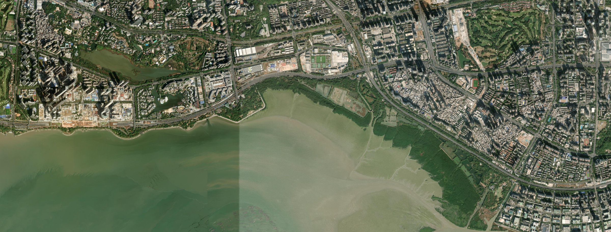

# 深圳湾岸线踏勘：东侧南向海堤、平台与垂钓边界

查阅与评估：2026年10月10日。资料日期逐条保留；尚未完成现场核查。

04深圳湾：东侧朝南岸线八段的影像与使用条件，南北观海栈桥及A02、A03的独立评估，以及禁渔、鱼类和环境证据。

东侧南向海堤、短平台、凹口与湿地过渡段逐段判读，八段均作为合法岸上观察对象，不安排试钓。深圳湾大桥以东海域禁钓有2026年管理答复；南桥有单独开放依据，A03短T形设施仍须核实名称、用途和边界。鱼情按浸水硬结构、软底、潮沟与盐度分别提出待验证假设。

[专题网页](shenzhen-bay.html) · [04深圳湾图集](atlas.html#S04) · [结构化证据](shenzhen-bay-evidence.json)

## 东侧朝南岸线：逐段影像踏勘

深圳湾东侧、北岸朝南的滨海带：从西端喇叭口形短平台沿海堤向东至红树林护岸，再到湿地围堤。八个1.6公里背景窗口衔接覆盖该带，500米近景用于结构分类；不是全湾可钓点清单。

这段岸线有人工硬结构，也有湿地软底与潮沟。结构上值得比较短平台、凹口抛石和岬头两肩；行程上，它们位于大桥以东禁渔水域，2026年公园管理答复明确禁止垂钓捕捞，均不安排试钓。南桥开放依据和人才公园水域例外不能推广到这些南向岸段。

### E01 喇叭口形短平台与阶梯岸

禁钓水域：仅作合法岸上观察；短突堤／阶梯护岸

[500米近景](E01_fine_east_shore.jpg) · [1.6公里背景](E01_east_shore.jpg) · [150米细看](E01_micro_east_shore.jpg)

影像观察：两条短直线硬边向海伸出，中间为阶梯与内凹水面，两侧接连续海堤。形态与北湾鹭港的官方景观描述相近；正式节点名未现场核实。

人的使用条件：从红树湾／红树湾南方向比选公众过街入口；影像中人行跨线设施可见，但出口与绕行距离须核对。平台与阶梯属于游客通道，不能占用，也不下堤。

鱼类与环境假设：平台内角与外端可形成不同遮蔽，高潮时阶梯和石脚浸水面积可能增加。不能把外端突出误认成深水；退潮时需比较内凹浅滩。

观察时机：低水位看台阶、护岸石脚与露滩，高水位看内凹区与外端实际漂流差别。只在开放步道观察。

现场核对：核对管理牌与公众入口；记录实际浸水结构、露滩和漂流。没有点位水深、海床测量、逐点鱼类记录或长期人流统计，不以卫星图推出这些结果。

近景中心WGS84：东经113.958806°，北纬22.521610°；不是钓位。

依据：[广东省农业农村厅：深圳湾禁渔通告（粤农农规〔2024〕3号）](https://dara.gd.gov.cn/zwgk/zcwj/content/post_4658454.html)；[问政深圳第286期：市公园管理中心关于深圳湾垂钓的答复](https://www.sznews.com/zhuanti/content/2026-05/29/content_32070785.htm)；[深圳湾公园官方介绍及咨询方式](https://www.szns.gov.cn/mlns/stns/kh/bhgy/content/post_12595646.html)；[深圳市交通运输局：地铁线路信息](https://jtys.sz.gov.cn/zwgk/ztzl/ggqsydw/jt/dt/ywxx/dtxlxx/content/post_11086812.html)；[南山区城管局：深圳湾公园景观节点介绍](https://www.szns.gov.cn/mlns/stns/gyzq/content/post_3726095.html)；[深圳特区报：深圳湾渔业资源监测采访](https://www.sznews.com/news/content/2024-06/12/content_31012262.htm)

### E02 连续直堤上的浅凹口

禁钓水域：仅作合法岸上观察；直线海堤／小凹口

[500米近景](E02_fine_east_shore.jpg) · [1.6公里背景](E02_east_shore.jpg) · [150米细看](E02_micro_east_shore.jpg)

影像观察：沿岸步道连续，局部有多个小型圆弧凹口，凹口两侧护岸向海突出；陆侧可见建筑、道路和工程地块。凹口用途和排水关系尚未确认；不把它们视为可站立的平台。

人的使用条件：可与E01沿公众滨海步道串看；不要把陆侧工程入口当捷径。红树湾南一带只是交通比选，未测最近站口与末段步行。

鱼类与环境假设：小凹口及两肩可能影响沿岸流和形成局部遮蔽，但水下若仍是平坦软底，未必提供岩栖鱼所需孔隙。相比抛石、桩脚，单纯直墙不能优先推定为石斑栖位。

观察时机：相近潮位下对比小凹口两侧与直堤背景；记录实际浸水边缘、水面漂流和饵鱼活动。

现场核对：核对管理牌与公众入口；记录实际浸水结构、露滩和漂流。没有点位水深、海床测量、逐点鱼类记录或长期人流统计，不以卫星图推出这些结果。

近景中心WGS84：东经113.964350°，北纬22.521952°；不是钓位。

依据：[广东省农业农村厅：深圳湾禁渔通告（粤农农规〔2024〕3号）](https://dara.gd.gov.cn/zwgk/zcwj/content/post_4658454.html)；[问政深圳第286期：市公园管理中心关于深圳湾垂钓的答复](https://www.sznews.com/zhuanti/content/2026-05/29/content_32070785.htm)；[深圳湾公园官方介绍及咨询方式](https://www.szns.gov.cn/mlns/stns/kh/bhgy/content/post_12595646.html)；[深圳市交通运输局：地铁线路信息](https://jtys.sz.gov.cn/zwgk/ztzl/ggqsydw/jt/dt/ywxx/dtxlxx/content/post_11086812.html)；[深圳特区报：深圳湾渔业资源监测采访](https://www.sznews.com/news/content/2024-06/12/content_31012262.htm)

### E03 半圆凹口与粗糙堤脚

禁钓水域：仅作合法岸上观察；凹口护岸／抛石边缘

[500米近景](E03_fine_east_shore.jpg) · [1.6公里背景](E03_east_shore.jpg) · [150米细看](E03_micro_east_shore.jpg)

影像观察：直堤中有明显半圆凹口，两侧水线外缘纹理粗糙，岸上为连续步道；邻近大型建筑和施工地块。不能据建筑工地推定步道关闭。

人的使用条件：沿E02步道接近，核对施工绕行、围栏及公众入口。收线与起鱼位置未核实，现阶段只观察，不布置钓位。

鱼类与环境假设：比光滑直堤更值得核对的是浸水抛石、内凹缓水与硬软底交界。黄鳍鲷有深圳湾区域记录；石斑类仍需足够硬结构与水深，石狗公没有本段确认记录。

观察时机：白天低水位辨认粗糙边缘是否真是松散抛石；较高水位观察内凹水面是否与外海充分交换。

现场核对：核对管理牌与公众入口；记录实际浸水结构、露滩和漂流。没有点位水深、海床测量、逐点鱼类记录或长期人流统计，不以卫星图推出这些结果。

近景中心WGS84：东经113.971254°，北纬22.522805°；不是钓位。

依据：[广东省农业农村厅：深圳湾禁渔通告（粤农农规〔2024〕3号）](https://dara.gd.gov.cn/zwgk/zcwj/content/post_4658454.html)；[问政深圳第286期：市公园管理中心关于深圳湾垂钓的答复](https://www.sznews.com/zhuanti/content/2026-05/29/content_32070785.htm)；[深圳湾公园官方介绍及咨询方式](https://www.szns.gov.cn/mlns/stns/kh/bhgy/content/post_12595646.html)；[深圳市交通运输局：地铁线路信息](https://jtys.sz.gov.cn/zwgk/ztzl/ggqsydw/jt/dt/ywxx/dtxlxx/content/post_11086812.html)；[深圳特区报：深圳湾渔业资源监测采访](https://www.sznews.com/news/content/2024-06/12/content_31012262.htm)

### E04 弧形岬头与连续护岸

禁钓水域：仅作合法岸上观察；弧形海堤／转角

[500米近景](E04_fine_east_shore.jpg) · [1.6公里背景](E04_east_shore.jpg) · [150米细看](E04_micro_east_shore.jpg)

影像观察：岸线呈圆弧形向海突出，外缘连续护岸，陆侧有绿化、步道及道路跨线设施。没有看到长码头或独立防波堤。

人的使用条件：可从深湾或红树湾南方向比选入园路线，再沿步道到岬头。是否人少、是否存在钓鱼活动没有现场统计；不按卫星图空旷程度判断钓压。

鱼类与环境假设：可比较岬头两肩与正前方的流水差别，但突出轮廓本身不证明有深槽或鱼群。鱼类价值取决于浸水石缝、可用盐度与流速，而不是地面树荫或景观名称。

观察时机：同一潮段观察两肩和正前方漂流；不预设南向迎风一定更好，需考虑当天风浪、浑浊与岸边交换。

现场核对：核对管理牌与公众入口；记录实际浸水结构、露滩和漂流。没有点位水深、海床测量、逐点鱼类记录或长期人流统计，不以卫星图推出这些结果。

近景中心WGS84：东经113.976992°，北纬22.521269°；不是钓位。

依据：[广东省农业农村厅：深圳湾禁渔通告（粤农农规〔2024〕3号）](https://dara.gd.gov.cn/zwgk/zcwj/content/post_4658454.html)；[问政深圳第286期：市公园管理中心关于深圳湾垂钓的答复](https://www.sznews.com/zhuanti/content/2026-05/29/content_32070785.htm)；[深圳湾公园官方介绍及咨询方式](https://www.szns.gov.cn/mlns/stns/kh/bhgy/content/post_12595646.html)；[深圳市交通运输局：地铁线路信息](https://jtys.sz.gov.cn/zwgk/ztzl/ggqsydw/jt/dt/ywxx/dtxlxx/content/post_11086812.html)；[深圳特区报：深圳湾渔业资源监测采访](https://www.sznews.com/news/content/2024-06/12/content_31012262.htm)

### E05 步道南凸转角与岸上出口

禁钓水域：仅作合法岸上观察；海堤转角／护岸石脚

[500米近景](E05_fine_east_shore.jpg) · [1.6公里背景](E05_east_shore.jpg) · [150米细看](E05_micro_east_shore.jpg)

影像观察：绿化岸段向南凸出，步道随之弯折，陆侧有道路和连接公园的设施；海侧是连续硬质岸缘。入口设施的正式名称与地铁出口对应关系未核实。

人的使用条件：东段可优先从9号线深圳湾公园站官方指引的A、C、D2口入园，再核对沿步道到本段的方向。2026管理答复特别提到D2广场旁出海口违规捕捞；本影像尚未与该出海口逐一对应，不能把便利入口理解成允许钓鱼。

鱼类与环境假设：转角可能改变沿岸水流，局部饵鱼与虾蟹线索值得观察；水色变深不能证明深水。水下遮蔽和软底仍需分别确认。

观察时机：观察出水口是否有实际排水、近岸漂浮物及暴雨后的浑浊范围。不要把“河口聚鱼”当作试钓许可或保证。

现场核对：核对管理牌与公众入口；记录实际浸水结构、露滩和漂流。没有点位水深、海床测量、逐点鱼类记录或长期人流统计，不以卫星图推出这些结果。

近景中心WGS84：东经113.985161°，北纬22.522839°；不是钓位。

依据：[广东省农业农村厅：深圳湾禁渔通告（粤农农规〔2024〕3号）](https://dara.gd.gov.cn/zwgk/zcwj/content/post_4658454.html)；[问政深圳第286期：市公园管理中心关于深圳湾垂钓的答复](https://www.sznews.com/zhuanti/content/2026-05/29/content_32070785.htm)；[深圳湾公园官方介绍及咨询方式](https://www.szns.gov.cn/mlns/stns/kh/bhgy/content/post_12595646.html)；[深圳市交通运输局：地铁线路信息](https://jtys.sz.gov.cn/zwgk/ztzl/ggqsydw/jt/dt/ywxx/dtxlxx/content/post_11086812.html)；[深圳特区报：深圳湾渔业资源监测采访](https://www.sznews.com/news/content/2024-06/12/content_31012262.htm)

### E06 长直护岸与湿地过渡角

禁钓水域：仅作合法岸上观察；直堤／折角／湿地边缘

[500米近景](E06_fine_east_shore.jpg) · [1.6公里背景](E06_east_shore.jpg) · [150米细看](E06_micro_east_shore.jpg)

影像观察：岸缘由长直线护岸连接折角，陆侧树木较密，海侧有浅色条带。仅凭本次水面颜色不能区分露滩、浑水或水下底质。

人的使用条件：从东侧公园公众步道接近，不穿越树林和养护通道。与主入口距离可能增加，实际步行和临时围挡未量测；没有证据证明这里钓压较低。

鱼类与环境假设：硬岸与浅滩邻接可形成食物边缘，黄鳍鲷、黄姑鱼只作为区域核对对象。若近岸以细软底为主，寻找石狗公的优先级应低于已验证的浸水粗石孔隙。

观察时机：在开放时间内比较低水位条带的真实性质，再观察涨水后是否被淹没及是否有小鱼虾活动。

现场核对：核对管理牌与公众入口；记录实际浸水结构、露滩和漂流。没有点位水深、海床测量、逐点鱼类记录或长期人流统计，不以卫星图推出这些结果。

近景中心WGS84：东经113.992066°，北纬22.524000°；不是钓位。

依据：[广东省农业农村厅：深圳湾禁渔通告（粤农农规〔2024〕3号）](https://dara.gd.gov.cn/zwgk/zcwj/content/post_4658454.html)；[问政深圳第286期：市公园管理中心关于深圳湾垂钓的答复](https://www.sznews.com/zhuanti/content/2026-05/29/content_32070785.htm)；[深圳湾公园官方介绍及咨询方式](https://www.szns.gov.cn/mlns/stns/kh/bhgy/content/post_12595646.html)；[深圳市交通运输局：地铁线路信息](https://jtys.sz.gov.cn/zwgk/ztzl/ggqsydw/jt/dt/ywxx/dtxlxx/content/post_11086812.html)；[深圳特区报：深圳湾渔业资源监测采访](https://www.sznews.com/news/content/2024-06/12/content_31012262.htm)

### E07 树林后方步道与植被贴岸带

禁钓水域：仅作合法岸上观察；硬质步道／植被潮间带

[500米近景](E07_fine_east_shore.jpg) · [1.6公里背景](E07_east_shore.jpg) · [150米细看](E07_micro_east_shore.jpg)

影像观察：500米近景内有大片树林，东南边可见滨海步道，海侧有贴岸植被；画面中还包含小型池塘和陆侧设施。树林遮挡处不能判定公众穿行。

人的使用条件：只沿已开放的滨海步道观察，禁止把林内小路当作下岸路线。公园与保护地入口、巡护通道边界须核对；观鸟人流与钓压不能互相替代。

鱼类与环境假设：植被边缘和小水道可能提供幼鱼遮蔽，但这体现湿地生境价值，不是开放岸钓条件。陆侧池塘与海水潮间带应分开识别。

观察时机：白天在公众步道观察潮水是否接近植被根部；避免进入潮间带。10月至次年5月是官方介绍的候鸟停歇期，观察路线需顾及鸟类。

现场核对：核对管理牌与公众入口；记录实际浸水结构、露滩和漂流。没有点位水深、海床测量、逐点鱼类记录或长期人流统计，不以卫星图推出这些结果。

近景中心WGS84：东经113.995567°，北纬22.526048°；不是钓位。

依据：[广东省农业农村厅：深圳湾禁渔通告（粤农农规〔2024〕3号）](https://dara.gd.gov.cn/zwgk/zcwj/content/post_4658454.html)；[问政深圳第286期：市公园管理中心关于深圳湾垂钓的答复](https://www.sznews.com/zhuanti/content/2026-05/29/content_32070785.htm)；[深圳湾公园官方介绍及咨询方式](https://www.szns.gov.cn/mlns/stns/kh/bhgy/content/post_12595646.html)；[深圳市交通运输局：地铁线路信息](https://jtys.sz.gov.cn/zwgk/ztzl/ggqsydw/jt/dt/ywxx/dtxlxx/content/post_11086812.html)；[深圳人大：红树林湿地保护若干规定](https://www.szrd.gov.cn/v2/zx/qwfb/hygg/content/post_1968673.html)；[深圳特区报：深圳湾渔业资源监测采访](https://www.sznews.com/news/content/2024-06/12/content_31012262.htm)

### E08 红树林池塘围堤与潮沟

禁钓水域：仅作合法岸上观察；湿地围堤／潮沟／浅滩

[500米近景](E08_fine_east_shore.jpg) · [1.6公里背景](E08_east_shore.jpg) · [150米细看](E08_micro_east_shore.jpg)

影像观察：近景可见被树木包围的水面、狭长围堤、泥滩条纹与水沟；没有连续城市滨海游憩步道贯穿。该帧用于判别东段终点的保护湿地环境。

人的使用条件：不把围堤或巡护小路列为公众步行路线，也不安排穿行下岸。保护区的精确边界未与影像叠合；通行按管理方开放区域核查。

鱼类与环境假设：潮沟、泥滩与植被构成食物及庇护环境，不能把可见围堤当作防波堤钓位。这里只做生态解释，不推定鱼种在场或捕获可能。

观察时机：只从依法开放的观察区域看潮沟淹露与鸟类觅食。湿地新规定2026年11月5日起施行；当前禁渔通告已独立适用。

现场核对：核对管理牌与公众入口；记录实际浸水结构、露滩和漂流。没有点位水深、海床测量、逐点鱼类记录或长期人流统计，不以卫星图推出这些结果。

近景中心WGS84：东经114.008404°，北纬22.527243°；不是钓位。

依据：[广东省农业农村厅：深圳湾禁渔通告（粤农农规〔2024〕3号）](https://dara.gd.gov.cn/zwgk/zcwj/content/post_4658454.html)；[问政深圳第286期：市公园管理中心关于深圳湾垂钓的答复](https://www.sznews.com/zhuanti/content/2026-05/29/content_32070785.htm)；[深圳湾公园官方介绍及咨询方式](https://www.szns.gov.cn/mlns/stns/kh/bhgy/content/post_12595646.html)；[深圳市交通运输局：地铁线路信息](https://jtys.sz.gov.cn/zwgk/ztzl/ggqsydw/jt/dt/ywxx/dtxlxx/content/post_11086812.html)；[深圳人大：红树林湿地保护若干规定](https://www.szrd.gov.cn/v2/zx/qwfb/hygg/content/post_1968673.html)；[深圳特区报：深圳湾渔业资源监测采访](https://www.sznews.com/news/content/2024-06/12/content_31012262.htm)

## 东岸观察路线

### 公交或地铁后步行

分两段走：E01—E04从红树湾／红树湾南、深湾方向比选公众过街路线；E05—E07从9号线深圳湾公园站入园，官方指引A、C、D2口。站名及公园入口有公开依据，最近出口、实走距离、末班车和当前绕行仍未测。E08围堤不列为公众穿行路线。

### 自驾与游客压力

1、2号停车场自2026年2月3日试点取消预约，出发前查i深圳实际车位和当日入场规则；其他停车场逐场查询。不要把滨海大道路边当停车点。该公园有明确游客需求和停车压力，但八段各自的人数、是否热门及钓鱼压力没有统计；树多或远离出口不能推出钓压低。

### 鱼类为何可能使用这些结构

深圳湾调查报道支持黄鳍鲷、黄姑鱼、六带石斑鱼的区域存在；没有八段逐点样表。比较潮水覆盖的抛石缝隙、平台外端与内角、硬软底接触边缘，才有助于判断栖息条件。红树林潮沟更偏湿地生境，不能一概归为岩栖鱼点；石狗公仍无本段确认依据。

### 何时看、何时钓

八段只安排白天合法岸上观察：低水位辨认露滩与石脚，较高水位看淹没范围与实际漂流；参考潮表但不把预测高潮等同转流。雨后记录淡水、浑浊与漂浮垃圾，不先判更好或更差。这里没有可给出的合法试钓时段；南桥需单独核对当日开放细则。

### 影像能看多清楚

八处近景中心元数据标注拍摄日期2026年1月25日，源分辨率约0.31—0.34米；500米1800像素导出采样约0.28米，150米视图用于细看，同样不会增加源影像细节。拍摄日期只适用查询坐标，拼接图其他区域可能不同；2026年10月的入口和施工状态不是实时可见。

## 岸段与行程取舍

### 南山区人才公园海域与人工湖

**通告排除该海域；当前垂钓开放未确认**

人的使用条件：园内是否有指定钓区、可用岸边和方式需向人才公园管理方核对。2019转载园规写有禁钓，但尚未取得现行完整官方须知；不能据通告例外直接到场开钓。

鱼类与结构线索：湖内、出海口与外侧深圳湾的水体交换和局部硬结构不同，鱼种及可达水深需独立判读，不能沿用东段八岸段结论。

仍待核查：海域例外的精确管理边界、现行园规、是否有开放钓区及2023拟议禁渔区方案的正式生效情况。

依据：[广东省农业农村厅：深圳湾禁渔通告（粤农农规〔2024〕3号）](https://dara.gd.gov.cn/zwgk/zcwj/content/post_4658454.html)；[深圳之窗：人才公园游园须知转载](https://city.shenchuang.com/city/20191120/1515670.shtml)；[深圳市规划和自然资源局：第二批禁渔区划定范围征求意见](https://pnr.sz.gov.cn/gkmlpt/content/11/11033/post_11033613.html)

### A02 大桥南侧圆端长栈桥

**优先核查；有公开开放依据**

人的使用条件：从西段公众滨水空间找桥口，核对桥名、钓区边缘、可用时段及游客动线。按部门答复倡导的一人一竿准备。

鱼类与结构线索：比较桥身与端头的实际流水、浸水硬结构和可收线水域。

仍待核查：桩脚形态、水深、当天鱼种及具体规则。

依据：[问政深圳第286期：市公园管理中心关于深圳湾垂钓的答复](https://www.sznews.com/zhuanti/content/2026-05/29/content_32070785.htm)；[深圳湾公园南北观海栈桥分区管理（政府网站刊载）](https://www.sz.gov.cn/cn/xxgk/zfxxgj/tpxw/content/post_12287576.html)；[深圳晚报：南北观海栈桥现场走访](https://www.sznews.com/news/content/mb/2025-06/05/content_31590296_0.htm)；[深圳湾公园官方介绍及咨询方式](https://www.szns.gov.cn/mlns/stns/kh/bhgy/content/post_12595646.html)

### 北观海栈桥

**明确禁钓；不安排试钓**

人的使用条件：管理采访与现场标识报道均确认禁钓，只用于合法观景和环境观察。

鱼类与结构线索：可能有生境线索仍不能改变使用规则。

仍待核查：本报告不另设可钓参考点。

依据：[深圳湾公园南北观海栈桥分区管理（政府网站刊载）](https://www.sz.gov.cn/cn/xxgk/zfxxgj/tpxw/content/post_12287576.html)；[深圳晚报：南北观海栈桥现场走访](https://www.sznews.com/news/content/mb/2025-06/05/content_31590296_0.htm)

### A03 西段短T形突堤与邻近海堤

**先查边界；不纳入直接试钓行程**

人的使用条件：短堤与邻近圆端长桥分别辨认，查设施用途、入口、标牌与水域边界。

鱼类与结构线索：若允许使用，再查堤脚硬结构和软底交界；不先认定为岩栖鱼点。

仍待核查：名称、用途、许可、软硬底分布和可达水深。

依据：[广东省农业农村厅：深圳湾禁渔通告（粤农农规〔2024〕3号）](https://dara.gd.gov.cn/zwgk/zcwj/content/post_4658454.html)；[深圳湾公园南北观海栈桥分区管理（政府网站刊载）](https://www.sz.gov.cn/cn/xxgk/zfxxgj/tpxw/content/post_12287576.html)；[深圳湾公园官方介绍及咨询方式](https://www.szns.gov.cn/mlns/stns/kh/bhgy/content/post_12595646.html)

### 大桥以东的深圳湾城市岸线

**部门答复明确禁钓；不安排自由试钓**

人的使用条件：部门答复明确大桥以东水域禁止垂钓捕捞，河口、海堤转角和平台不自动形成钓区。人才公园海域例外仍需独立核对公园管理。

鱼类与结构线索：调查可用于理解河口食物与鱼类分布，不能当作可钓点清单。

仍待核查：没有完整管理图层及逐段垂钓确认。

依据：[广东省农业农村厅：深圳湾禁渔通告（粤农农规〔2024〕3号）](https://dara.gd.gov.cn/zwgk/zcwj/content/post_4658454.html)；[问政深圳第286期：市公园管理中心关于深圳湾垂钓的答复](https://www.sznews.com/zhuanti/content/2026-05/29/content_32070785.htm)

### 红树林、内湾泥滩与画面内香港岸线

**生态观察背景；不列为本次深圳岸钓候选**

人的使用条件：分别遵守保护地、公众通行与香港一侧规则，不从深圳规则推定对岸许可。

鱼类与结构线索：泥滩、红树林及盐度季节变化用于解释湾内环境。

仍待核查：本调查未核实香港岸钓入口或许可。

依据：[香港渔护署：米埔及内后海湾湿地的水文与底质](https://www.afcd.gov.hk/english/conservation/con_wet/con_wet_look/con_wet_look_gen/con_wet_look_gen.html)；[深圳湾公园官方介绍及咨询方式](https://www.szns.gov.cn/mlns/stns/kh/bhgy/content/post_12595646.html)

## 影像辨认

### A02 深圳湾大桥南侧圆形端头栈桥

[500米近景](A02_fine_bay_south_pier.jpg) · [完整地点评估](atlas.html#A02)

WGS84近景中心：北纬22.485864°，东经113.943706°。这是影像参考中心，不是站立钓位。

### A03 深圳湾西段海堤与短T形突堤

[500米近景](A03_fine_bay_north_pier.jpg) · [完整地点评估](atlas.html#A03)

WGS84近景中心：北纬22.492198°，东经113.948300°。这是影像参考中心，不是站立钓位。

A03短T形突堤与其南侧另一座圆形端头长栈桥是两处结构；短堤尚未确认为北观海栈桥。A02按大桥相对位置与岸形对应南桥候选，正式桥名及钓区须到场核对。

## 证据与行程含义

### 先分水域边界，再分公园钓区

依据性质：通告原文

深圳湾禁渔区约25.19平方公里，位于深港跨海大桥以东、粤港水域边界线以北至深圳陆域之间，不包括人才公园海域部分；全年全时段禁渔，通告有效期至2029年4月30日。

**行程含义：**大桥以东深圳湾水域的垂钓与捕捞，部门答复明确予以禁止；通告对人才公园海域的例外仍需独立查公园管理，不能推定开放。

**适用限度：**卫星图的分区矩形不是禁渔边界；通告界点坐标未标明大地基准，本报告不据此绘制精确禁渔多边形。

依据：[广东省农业农村厅：深圳湾禁渔通告（粤农农规〔2024〕3号）](https://dara.gd.gov.cn/zwgk/zcwj/content/post_4658454.html)；[问政深圳第286期：市公园管理中心关于深圳湾垂钓的答复](https://www.sznews.com/zhuanti/content/2026-05/29/content_32070785.htm)

### 人才公园海域有例外，园内开放仍需独立确认

依据性质：通告原文、园规转载与征求意见材料分别核对

2024年深圳湾禁渔通告明确不包含南山区人才公园海域部分；2019年深圳之窗转载的游园须知写有园内禁止投网捕鱼、钓鱼。本次未取得较新的官方垂钓开放公告或现行完整园规。

**行程含义：**人才公园不按该通告直接归为深圳湾禁渔区，也不列为已确认可钓点。问园区管理方是否有指定开放区，并把人工湖、出海口与外侧深圳湾岸线分别核对。

**适用限度：**海域例外没有附可直接套用的详细边界图；2019转载不能替代2026现场规则。2023拟将人工湖纳入第二批禁渔区的材料只是征求意见稿，本次未取得正式生效依据。

依据：[广东省农业农村厅：深圳湾禁渔通告（粤农农规〔2024〕3号）](https://dara.gd.gov.cn/zwgk/zcwj/content/post_4658454.html)；[深圳之窗：人才公园游园须知转载](https://city.shenchuang.com/city/20191120/1515670.shtml)；[深圳市规划和自然资源局：第二批禁渔区划定范围征求意见](https://pnr.sz.gov.cn/gkmlpt/content/11/11033/post_11033613.html)

### 南桥有开放依据，北桥明确禁钓

依据性质：部门答复汇编与管理采访

2026年5月29日《问政深圳》汇编刊载市公园管理中心答复，将南桥作为垂钓区，并倡导一人一竿。北观海栈桥禁钓有2025年7月政府网站刊载的管理说明。

**行程含义：**A02可作为深圳湾首个到场核查目标；北桥用于观景与环境观察，不安排试钓。

**适用限度：**答复汇编不是出行当天开放确认。允许的具体岸边、时段、钓法及饵料仍须核对；一人一竿按管理方倡导表述，不扩写成未公布的钩数或线数限制。

依据：[问政深圳第286期：市公园管理中心关于深圳湾垂钓的答复](https://www.sznews.com/zhuanti/content/2026-05/29/content_32070785.htm)；[深圳湾公园南北观海栈桥分区管理（政府网站刊载）](https://www.sz.gov.cn/cn/xxgk/zfxxgj/tpxw/content/post_12287576.html)

### A03短T形突堤须独立辨认

依据性质：保存影像判读

A03近景中，短T形突堤与其南侧另一座圆形端头长栈桥是两处结构；短堤正式名称、用途和入口尚未核实。A02圆端长桥按相对大桥的位置对应南桥候选。

**行程含义：**不能把“北桥禁钓”直接贴在A03上，也不能把“南桥开放”推广到短堤、附近直线海堤或堤脚。

**适用限度：**结构识别来自卫星影像；正式桥名、公众入口与可垂钓边缘需要现场核对。

依据：[深圳湾公园南北观海栈桥分区管理（政府网站刊载）](https://www.sz.gov.cn/cn/xxgk/zfxxgj/tpxw/content/post_12287576.html)；[深圳湾公园官方介绍及咨询方式](https://www.szns.gov.cn/mlns/stns/kh/bhgy/content/post_12595646.html)

### 西段行程按实际桥位选入口

依据性质：官方出行资料与路线比选

官方公布公园6:00—23:00开放，西段地址为望海路旁。地铁站表列2/8号线湾厦、海月、东角头，以及13号线深圳湾口岸；9号线深圳湾公园站是另一处区域入口。

**行程含义：**A02、A03从西段岸边接近，先比较上述站点至目标的步行路线。自驾查目的停车场开放、预约、车位及出场后的岸边路线。

**适用限度：**没有核实最近出口、末班公交或实走距离。公园开放时间不是垂钓时段；六处智慧停车场也不等于都适合去南桥。

依据：[深圳湾公园官方介绍及咨询方式](https://www.szns.gov.cn/mlns/stns/kh/bhgy/content/post_12595646.html)；[深圳市交通运输局：地铁线路与站点](https://jtys.sz.gov.cn/zwgk/ggqsydw/dt/)；[深圳市城管局：深圳湾公园停车设施与服务](https://cgj.sz.gov.cn/hdjl/bmxx/content/post_12847933.html)

### 望海路与后海河口施工需查当天通行

依据性质：工程公示

工程用海公示明确涉海段在深圳歌剧院东北侧、后海河河口，涉及明挖施工和围堰。

**行程含义：**路线遇围挡时确认公众绕行通道，重新判断是否能到桥口；不要按影像中的道路直接认定通行。

**适用限度：**2025年公示没有给出2026年围挡范围，不据此声称A02、A03目前封闭，也不把工程高程当作钓位水深。

依据：[深圳市规划和自然资源局：望海路工程用海公示](https://pnr.sz.gov.cn/xxgk/gggs/content/post_12048527.html)

### 内湾泥滩与人工硬结构要分开看

依据性质：区域环境资料

渔护署描述内后海湾为浅水河口湾，潮间带泥滩主体为黏土和粉砂，雨季盐度下降，旱季盐度上升。

**行程含义：**深圳湾的踏勘应同时记录软底背景与局部桩脚、堤脚、抛石的浸水遮蔽，不能只搜索外露礁石。

**适用限度：**这是内湾湿地资料，不证明A02脚下为泥底；也不能将内湾平均水深套用到西段人工结构。

依据：[香港渔护署：米埔及内后海湾湿地的水文与底质](https://www.afcd.gov.hk/english/conservation/con_wet/con_wet_look/con_wet_look_gen/con_wet_look_gen.html)

### 盐度、透明度与溶解氧比水色更有解释力

依据性质：年度监测

2025年香港侧DM1—DM5监测显示内外湾的盐度与透明度存在差异；DM1年平均盐度16.0，DM5为26.7，DM4年平均溶解氧6.7毫克／升。

**行程含义：**推测：降雨径流与潮水交换可能改变近岸可用环境，试钓记录应包含雨情、水色、漂流方向及鱼讯，而不是只写潮位。

**适用限度：**五站各有12次采样，是香港离岸年度数据。不能推出南桥当天缺氧、适合垂钓或鱼可安全食用；透明度也不是水深。

依据：[香港环保署：2025年海水水质报告，后海湾监测表](https://www.epd.gov.hk/epd/sites/default/files/epd/english/environmentinhk/water/hkwqrc/files/waterquality/annual-report/marinereport2025.pdf)

### 湾内鱼类记录支持候选，不能定位鱼群

依据性质：机构调查的新闻报道

2024年采访报道2013—2023年累计10航次的湾内外调查，提到黄鳍鲷、黄姑鱼、六带石斑鱼等经济鱼类。

**行程含义：**黄鳍鲷与黄姑鱼可作为河口湾岸钓的核对对象；六带石斑鱼只有区域记录，需先确认局部浸水硬结构与可达水深。

**适用限度：**未获得逐站样表，不能将禁渔区调查结果直接分配给南桥。现有深圳湾资料也不足以把石狗公列为已确认目标鱼。

依据：[深圳特区报：深圳湾渔业资源监测采访](https://www.sznews.com/news/content/2024-06/12/content_31012262.htm)；[香港渔护署：人工鱼礁类别](https://www.afcd.gov.hk/tc_chi/fisheries/ar/type_of_ar.html)

### 南桥有钓鱼人流，渔获水平仍未知

依据性质：单次现场走访

2025年6月5日走访报道记录南桥多人垂钓，多数当日收获较少，仅有小鱼；报道也提到多竿和乱扔垃圾行为会被劝阻。

**行程含义：**按已有钓鱼活动的城市钓点规划：评估空位、抛投方向、游客动线和起鱼空间。

**适用限度：**一次雨天走访不能推出年平均渔获、周末人数或长期钓压；视频中的大鱼不作为选点成绩。

依据：[深圳晚报：南北观海栈桥现场走访](https://www.sznews.com/news/content/mb/2025-06/05/content_31590296_0.htm)

### 较高水位与缓流是试验条件

依据性质：踏勘方案

2026年潮汐表可查询尖鼻咀等站的高低潮预测；天文台说明潮时潮差随站位变化。

**行程含义：**先在白天低水位观察浸水范围，再在获准的岸边比较较高水位与可控流水。记录实际水位和漂流，积累同点、同钓组的咬口比较。

**适用限度：**这是一套待验证的试钓方案，不是已证实的最佳潮段。高低潮时刻不等于南桥转流，预测潮高不是钓位水深。

依据：[香港天文台：2026年潮汐表与潮汐说明](https://www.hko.gov.hk/sc/tide/tidetable2026.html)；[香港天文台：潮汐预测的基准与适用范围](https://www.hko.gov.hk/sc/tide/enotes.htm)

## 禁渔通告列出的海上界点

| 海上界点 | 东经（通告原值） | 北纬（通告原值） |
|---|---|---|
| 深圳河入海口 | 114°02′38.41″ | 22°30′15.45″ |
| 深圳湾84号航灯标 | 113°59′42.20″ | 22°30′36.23″ |
| 深圳湾大桥中部交点 | 113°57′14.84″ | 22°28′38.82″ |
| 深圳湾大桥蛇口东角头桥头 | 113°56′45.55″ | 22°29′23.14″ |

海上连线与深圳海岸线共同形成禁渔范围。原文未注明大地基准，四点不是完整岸线多边形，也不是可站立钓位；不能直接与WGS84影像叠合判断贴边位置。依据：[广东省农业农村厅：深圳湾禁渔通告（粤农农规〔2024〕3号）](https://dara.gd.gov.cn/zwgk/zcwj/content/post_4658454.html)

## 后海湾水质区域参照

| 站位 | 区域 | 盐度年平均（范围） | 透明度年平均／米 | 溶解氧年平均／毫克每升 |
|---|---|---|---|---|
| DM1 | 内湾 | 16.0（5.4—22.9） | 1.2 | 6.8 |
| DM2 | 内湾 | 19.2（9.5—26.3） | 1.2 | 7.0 |
| DM3 | 内湾 | 22.2（12.0—28.9） | 1.3 | 6.6 |
| DM4 | 外湾 | 24.4（13.1—30.9） | 1.6 | 6.7 |
| DM5 | 外湾 | 26.7（17.2—32.0） | 1.9 | 7.1 |

2025年香港侧离岸监测，各站12次采样。数值为年度平均，括号为盐度观测范围；不是深圳岸钓点实测。透明度不是水深；未采样的底层溶解氧不表示为零。

表格见附录B-11（PDF第73页），站位见附录A-5（第55页）。依据：[香港环保署：2025年海水水质报告，后海湾监测表](https://www.epd.gov.hk/epd/sites/default/files/epd/english/environmentinhk/water/hkwqrc/files/waterquality/annual-report/marinereport2025.pdf)

## 南桥首轮踏勘方案

1. 到场先拍桥名、入口标识、钓区边缘与管理要求；确认允许使用的时段、钓法和饵料。按部门答复倡导的一人一竿准备。
2. 从公众平台记录栏杆高度、落脚范围、游客动线、抛投扇区、收线和起鱼路径；不把图像中心当作站位。
3. 在较低水位查看浸水硬结构和可见底质，再比较较高水位的覆盖范围；测深记录同时写明潮位参照及实际测量方式。
4. 只在获准且可控的水域试钓。桥身与端头采用相同钓组、饵料及相近观察时长，记录水色、雨情、漂流方向、挂底与每种鱼的咬口。
5. 把空军、无咬口、临时禁钓、无空位及无法收线都记入结果；据重复观察再决定是否值得常去。

建议每次记录：日期时间、站位照片、实际许可、天气及此前降雨、潮位参照、水色、漂流、可达水深与测法、钓组饵料、观察时长、挂底和各鱼种咬口。

## 仍需核实

- 南桥当天具体钓区、允许时段、钓法、饵料及临时封闭情况；按部门答复倡导的一人一竿准备。
- A03短T形结构的正式名称、用途、可用入口及所属水域。
- 两点水深、软硬底分布、浸水结构、实际流向和转流。
- 最近地铁出口、实走距离、当天末班及合适停车场。
- 逐点鱼类记录、重复试钓结果及可比较的钓鱼压力数据。
- 人才公园：取得现行游园须知和指定垂钓区公告，确认通告排除海域与外侧深圳湾的管理边界；本次没有取得2023拟议第二批禁渔区的正式生效依据。

公园咨询：0755-83706489；西段咨询：0755-21616774。需说清具体桥位或出示A03影像，询问当日入口、钓区、时段与方式。依据：[深圳湾公园官方介绍及咨询方式](https://www.szns.gov.cn/mlns/stns/kh/bhgy/content/post_12595646.html)

## 来源与适用范围

- [深圳湾公园南北观海栈桥分区管理（政府网站刊载）](https://www.sz.gov.cn/cn/xxgk/zfxxgj/tpxw/content/post_12287576.html)（2025-07-21）：公开资料称南桥为垂钓开放区、北桥禁钓；2026年具体点位、时段及方式仍需向管理方核对。
- [深圳湾公园官方介绍及咨询方式](https://www.szns.gov.cn/mlns/stns/kh/bhgy/content/post_12595646.html)（2026-01-12）：公园及西段的公众步行空间、咨询方式。公园开放时间不等于垂钓开放时间；深圳湾公园地铁站也不等于每座栈桥的最近站。
- [香港渔护署：人工鱼礁类别](https://www.afcd.gov.hk/tc_chi/fisheries/ar/type_of_ar.html)（网页标注2025-09-22）：人工材料可以增加生境复杂性；部署人工鱼礁的资料不能直接证明任何现役码头的鱼情。
- [广东省农业农村厅：深圳湾禁渔通告（粤农农规〔2024〕3号）](https://dara.gd.gov.cn/zwgk/zcwj/content/post_4658454.html)（2024-04-30；2024-05-01起施行，有效期5年）：现行通告的范围、四个海上界点、全年全时段禁渔和禁止捕捞养殖条款。原文未提供南桥垂钓时段，也不能把人才公园水域例外解释成垂钓许可。
- [深圳晚报：南北观海栈桥现场走访](https://www.sznews.com/news/content/mb/2025-06/05/content_31590296_0.htm)（2025-06-05）：记者核对北桥禁钓标识、采访公园管理方说明南桥允许垂钓，并记录当日钓鱼人流、少量小鱼及多竿行为受到劝阻。一次走访不代表平均渔获或2026年现场细则。
- [深圳特区报：深圳湾渔业资源监测采访](https://www.sznews.com/news/content/2024-06/12/content_31012262.htm)（2024-06-12；报道调查期2013—2023年）：报道专业机构累计10航次的湾内外调查及黄姑鱼、黄鳍鲷、六带石斑鱼等记录；没有逐站原始鱼类样表，不能定位为A02或A03的现存鱼群。
- [香港渔护署：米埔及内后海湾湿地的水文与底质](https://www.afcd.gov.hk/english/conservation/con_wet/con_wet_look/con_wet_look_gen/con_wet_look_gen.html)（网页标注2026-01-05；环境介绍）：内后海湾为浅水河口湿地，潮间带泥滩以黏土和粉砂为主，盐度受雨季与旱季影响。描述对象为内湾湿地，不能直接套用为深圳西段栈桥的底质或水深。
- [香港环保署：2025年海水水质报告，后海湾监测表](https://www.epd.gov.hk/epd/sites/default/files/epd/english/environmentinhk/water/hkwqrc/files/waterquality/annual-report/marinereport2025.pdf)（2025年监测；报告发布日期未核实，2026-10-10查阅）：附录B-11（PDF第73页）列DM1—DM5年平均盐度、透明度和溶解氧，附录A-5（第55页）列WGS84站位。香港侧离岸年度统计，不是深圳岸边实时测量、水深或食用安全检测。
- [深圳市交通运输局：地铁线路与站点](https://jtys.sz.gov.cn/zwgk/ggqsydw/dt/)（页面无明确更新日期；2026-10-10查阅）：确认2/8号线东角头、湾厦、海月，9号线深圳湾公园，13号线深圳湾口岸、人才公园等站名与线路。站表不证明最近出口、步行时间或滨水入口畅通。
- [深圳市城管局：深圳湾公园停车设施与服务](https://cgj.sz.gov.cn/hdjl/bmxx/content/post_12847933.html)（2026-06-17）：公园1、2、3、4、5、7号六处停车场接入智慧停车。未给出各场到南桥的路线或实时车位；不能据此指定最优停车场。
- [深圳市规划和自然资源局：望海路工程用海公示](https://pnr.sz.gov.cn/xxgk/gggs/content/post_12048527.html)（2025-02-25）：项目涉海段位于深圳歌剧院东北侧、后海河河口，含明挖施工围堰。公示只能提示道路与岸边入口须核查；不是当前围挡图或完工证明。附件未取得完整可读文件，不用于引用点位水深。
- [香港天文台：2026年潮汐表与潮汐说明](https://www.hko.gov.hk/sc/tide/tidetable2026.html)（2026年预测；2026-10-10查阅）：可查询尖鼻咀等站的预测高低潮时间与潮高。潮位资料是选取观察时段的参照，不能直接给出南桥水深、停流时刻或最佳鱼口。
- [香港天文台：潮汐预测的基准与适用范围](https://www.hko.gov.hk/sc/tide/enotes.htm)（页面无明确更新日期；2026-10-10查阅）：香港潮汐为不正规半日潮，站间潮时潮差不同；预测水位与实测水位各有定义。潮高相对海图基准，不能当作水面至海床深度。
- [问政深圳第286期：市公园管理中心关于深圳湾垂钓的答复](https://www.sznews.com/zhuanti/content/2026-05/29/content_32070785.htm)（2026-05-29汇编；答复具体日期未单独核实）：第16项刊载市公园管理中心答复：大桥以东海域禁止垂钓捕捞，南桥作为垂钓区，倡导一人一竿及文明摆放渔具。原帖链接未能读取；按可读汇编引用，不推定现场全部细则。
- [深圳人大：红树林湿地保护若干规定](https://www.szrd.gov.cn/v2/zx/qwfb/hygg/content/post_1968673.html)（2026-09-04公布；2026-11-05起施行）：第十五条规定红树林湿地及有红树林分布的其他湿地禁止捕鱼等活动。2026年10月10日尚未施行，不作为当日禁钓依据；现行深圳湾禁渔通告独立适用。
- [南方+刊载市公园管理中心停车公告与现场走访](https://static.nfnews.com/content/202602/07/c12150015.html?enterColumnId=8991)（2026-02-07；公告自2026-02-03试点）：1、2号停车场试点无需预约，i深圳可查剩余车位；不是其他停车场或出行当天的统一承诺。
- [深圳市交通运输局：地铁线路信息](https://jtys.sz.gov.cn/zwgk/ztzl/ggqsydw/jt/dt/ywxx/dtxlxx/content/post_11086812.html)（网页标注2024-01-04；2026-10-10查阅）：列明9号线红树湾南、深湾、深圳湾公园及2/8号线红树湾等站。只支持线路站名，未核实各岸段最近出口或步行时间。
- [南山区城管局：深圳湾公园景观节点介绍](https://www.szns.gov.cn/mlns/stns/gyzq/content/post_3726095.html)（2018-03-15；用于景观形态线索）：北湾鹭港的喇叭状双栈桥与阶梯描述可作名称比对线索，不能独立确认E01身份。文中垂钓描述不作为当前开放依据，按现行禁渔通告及2026管理答复判断。
- [深圳之窗：人才公园游园须知转载](https://city.shenchuang.com/city/20191120/1515670.shtml)（2019-11-20；尚未取得2026现行官方须知）：转载须知第5项写明禁止园内投网捕鱼、钓鱼。是较早的二手园规文本，不能独立证明2026全部规则；本次检索未取得人才公园现行垂钓开放公告。
- [深圳市规划和自然资源局：第二批禁渔区划定范围征求意见](https://pnr.sz.gov.cn/gkmlpt/content/11/11033/post_11033613.html)（2023-12-07；征求意见稿）：拟划定范围提到人才公园人工湖，但属于征求意见材料。本次未取得该方案正式生效通告，不能据草案宣布人才公园已纳入禁渔区。
